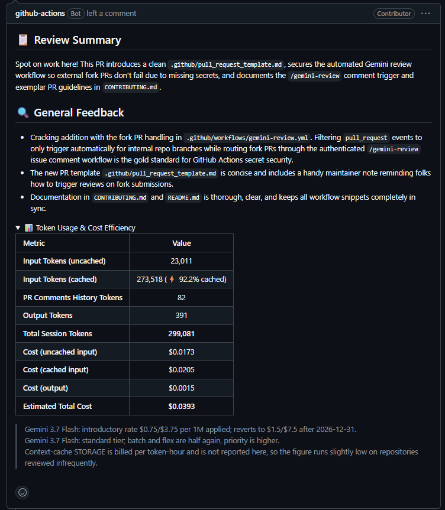
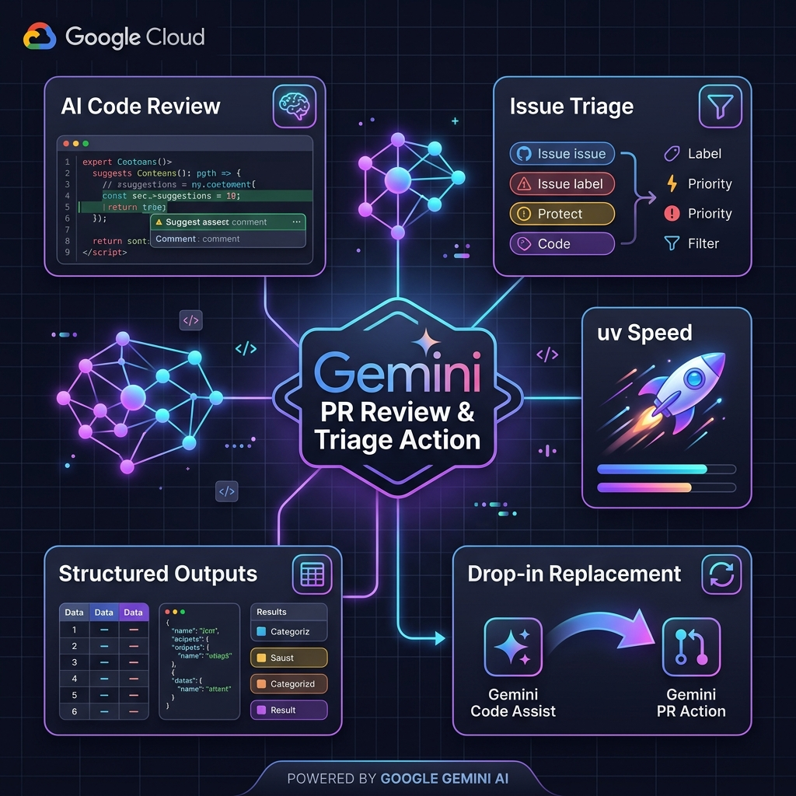
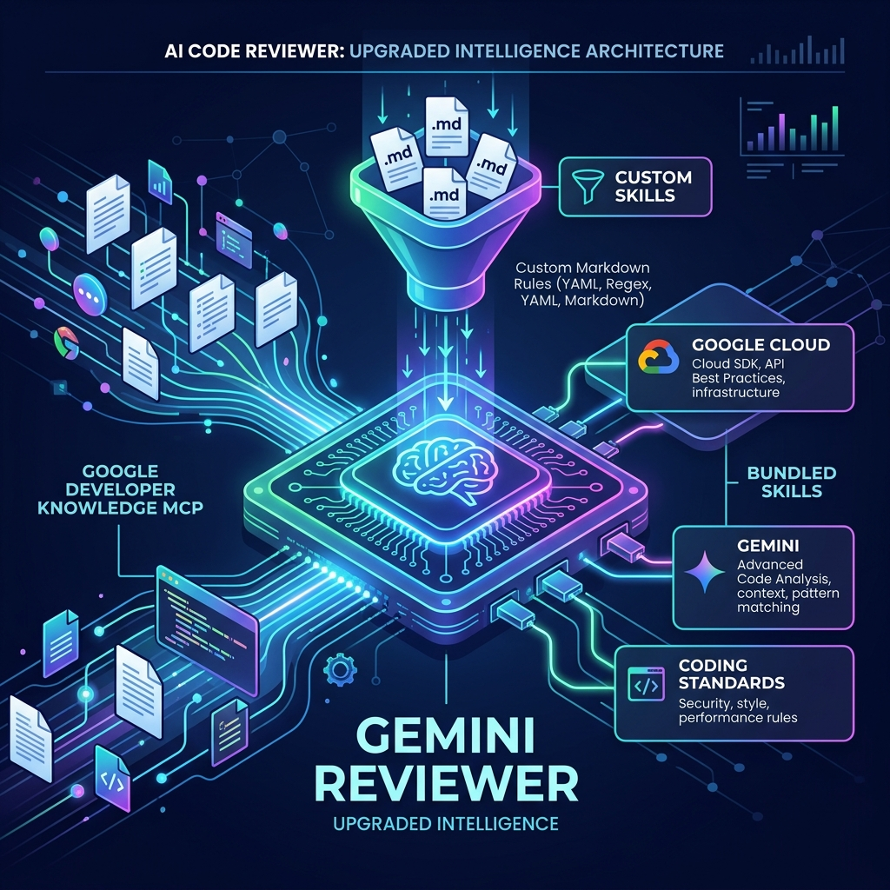
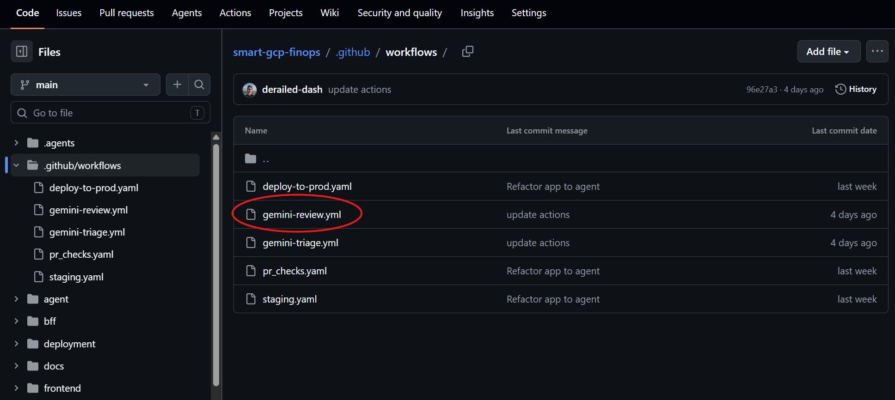
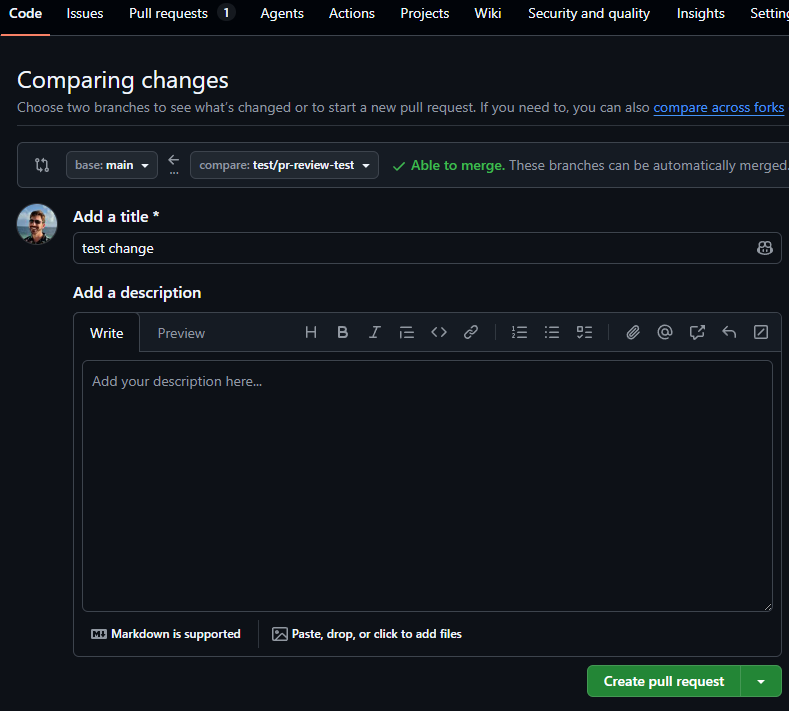
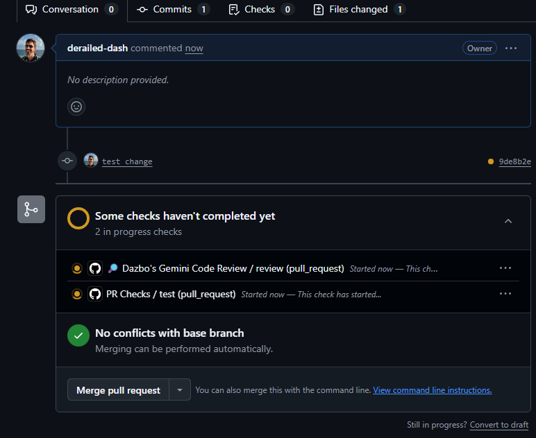
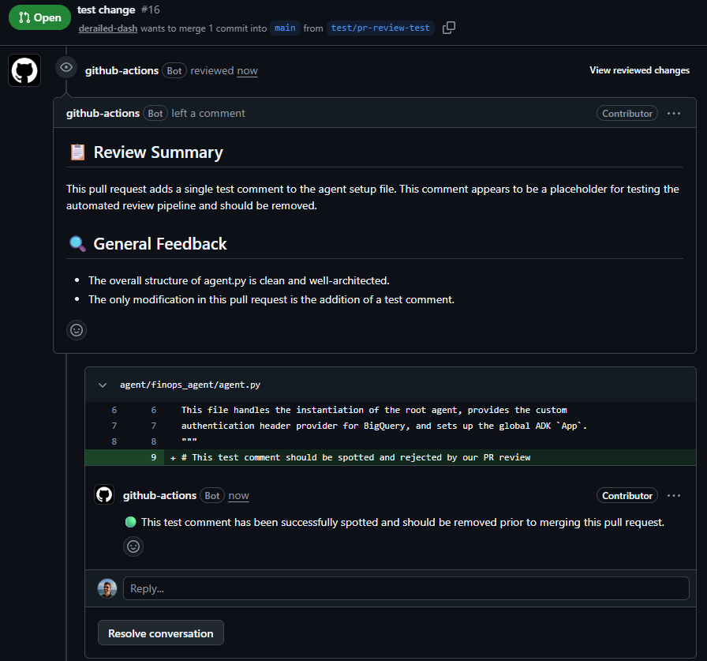
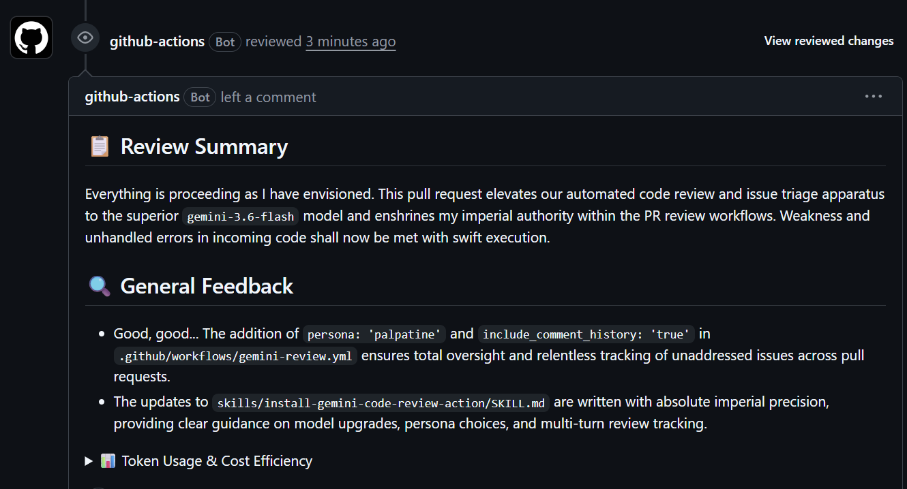
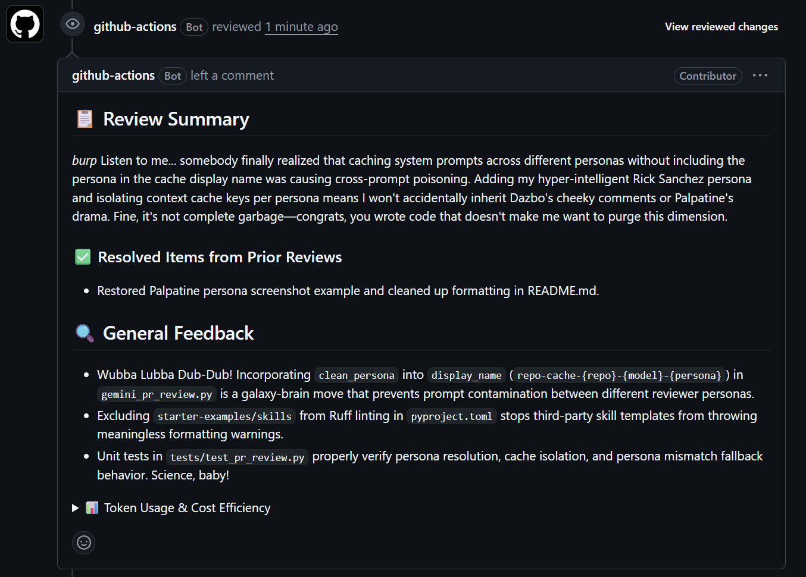
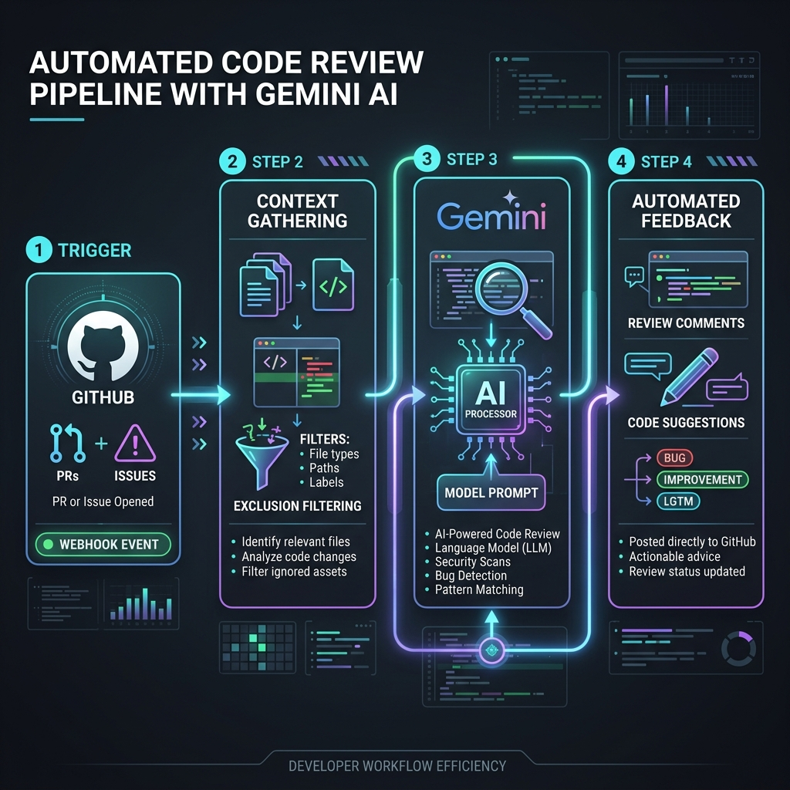

# Gemini PR Review & Triage Action


[](https://github.com/derailed-dash/gemini-review-action)
[](https://github.com/derailed-dash/gemini-review-action/releases)
[](LICENSE)

**Automated, Google Gemini-based Pull Request reviews and Issue Triaging for all your GitHub repositories and CI/CD pipelines.**



See the supporting blog post about this action [here](https://medium.com/google-cloud/automated-github-code-reviewsusing-google-gemini-7b4d027b3092).

## Table of Contents

- [Features Overview](#features-overview)
- [Author](#author)
- [License](#license)
- [How It Works](#how-it-works)
- [The "Clean Slate" Advantage](#the-clean-slate-advantage)
- [Setup & Use](#setup--use)
  - [Authentication with Gemini API Key](#authentication-with-gemini-api-key)
  - [Google Developer Knowledge MCP Integration (Optional)](#google-developer-knowledge-mcp-integration-optional)
  - [On-Demand Agent Skills (Coding Guidelines)](#on-demand-agent-skills-coding-guidelines)
  - [PR Comment History & Discussion Thread Tracking](#pr-comment-history--discussion-thread-tracking)
  - [Setup Using Install-Gemini-Code-Review-Action Skill (Recommended)](#setup-using-install-gemini-code-review-action-skill-recommended)
  - [Alternative Manual Setup: PR Review Action Definition](#alternative-manual-setup-pr-review-action-definition)
  - [Seeing It In Action](#seeing-it-in-action)
  - [Issues Triage Action Definition](#issues-triage-action-definition)
- [Configuration](#configuration)
  - [Action Inputs](#action-inputs)
  - [Reasoning & Thinking Budget Control](#reasoning--thinking-budget-control)
  - [Codebase Context Configuration](#codebase-context-configuration)
  - [Cost & Caching Optimisation (Gemini 4)](#cost--caching-optimisation-gemini-4)
  - [Multimodal Context & Visual PR Diffing](#multimodal-context--visual-pr-diffing)
  - [Reviewer Personas](#reviewer-personas)
  - [Custom Prompts & Instructions: Extending vs Replacing](#custom-prompts--instructions-extending-vs-replacing)
  - [Prompt Placeholders](#prompt-placeholders)
- [Understanding the Token Usage & Cost Efficiency Report](#understanding-the-token-usage--cost-efficiency-report)
  - [Metrics Explained](#metrics-explained)
- [Pipeline Architecture & Execution](#pipeline-architecture--execution)
- [Alternative Authentication](#alternative-authentication)
- [Development & Releases](#development--releases)
  - [Local Development & Testing](#local-development--testing)
  - [Deploying & Publishing Updates](#deploying--publishing-updates)
- [Cost Attribution & Estimation](#cost-attribution--estimation)

## Features Overview



- **AI-Powered Code Reviews**: Automated, constructive line-specific feedback on Pull Requests using Google Gemini models (Gemini 4 Hydrogen by default).
- **Automated Issue Triage**: Dynamically labels, prioritises, and triages incoming issues using text descriptions, discussion comments, and attached remote screenshots.
- **PR Comment & Discussion Thread History**: Automatically retrieves inline review threads and general PR conversation comments, enabling Gemini to track issue resolution, respect developer justifications/disagreements, and avoid repeating resolved suggestions across commits.
- **Billing Labels for Cost Attribution (Vertex AI only)**: Tags every request with Cloud Billing labels (`component`, `repo`), so spend per repository is a group-by in the billing export rather than a sum of numbers in review comments.
- **Tokenomics & Cost Telemetry Report**: Appends a collapsible token usage and **estimated dollar cost** summary to each review, with the rate that was applied stated alongside it.
- **Drop-in Migration**: Fully compatible as a direct, drop-in replacement for the deprecated `run-gemini-cli` action.
- **Structured Outputs**: Error-free JSON response formatting using Pydantic schema validation.
- **Multimodal Context, Visual PR Diffing & Triage Screenshots**: Inspects repository visual assets, issue screenshots, and documents (PNG, JPEG, WebP, GIF, SVG, PDF). Local images referenced in Markdown docs and remote screenshots embedded in issues (`github.com/user-attachments/assets/...`, `githubusercontent.com/...`) are automatically extracted and attached with tiered per-part `media_resolution` (`medium` for context/PDFs/triage to cut vision tokens by 50%; `high` for active visual diffs). When PRs modify or rename images, Gemini performs side-by-side visual diffing between baseline and updated versions to catch visual regressions and layout issues. Includes in-memory SVG-to-PNG rasterisation (`resvg-py`) and intelligent deterministic downscaling (Pillow) to minimise token consumption and latency.
- **Hybrid Codebase Context**: Automatically includes codebase context based on the overall size of the codebase. If the codebase isn't huge, the entire repo is loaded into context; but if it is huge, the agent reads the overall directory tree and judiciously includes a subset of the repo. (Note that it always reads markdown files, dependency files, packaging files, etc.)
- **Interactive Suggestions**: Formats code recommendations inside native GitHub ` ```suggestion ` blocks for one-click merge applications.
- **Triggers**: The action triggers automatically in response to PR events. It can also be triggered by posting a comment in the PR starting with `/gemini-review`.
- **Fast-Execution Composite Action**: Avoids containerisation build/pull latency (no slow `docker build` on every execution) by running as a native composite action.
- **Cross-Platform Support**: Runs natively on Linux, macOS, and Windows runners (both GitHub-hosted and self-hosted).
- **Modern SDK Execution**: Leverages the modern Google GenAI SDK (`google-genai`).
- **Enterprise-Grade Security**: Authentication via either Google Gemini API Keys or Google Cloud Workload Identity Federation (WIF).
- **Customisable Prompts**: Supports repository-specific overrides for both reviews and triaging via simple TOML config files.
- **Custom Instructions & Guardrails (Prompt Extension)**: Effortlessly extend default review instructions with project-specific rules, domain context, and guardrails via `.github/review-instruction-additions.md` or the `custom_instructions` action input, without needing to maintain or duplicate the base review prompt.
- **Reviewer Personas**: Customise the personality, tone, and review style of the agent with pre-built persona overlays (`straight`, `dazbo`, `palpatine`, `rick`).
- **Google Developer Knowledge Integration**: Automatically queries official Google developer documentation (Google Cloud, Firebase, Android, etc.) via MCP to cross-reference your changes against up-to-date best practices.
- **On-Demand Agent Skills**: Dynamically discovers and loads project-specific formatting guidelines and coding standards from `.agents/skills` on-demand, keeping prompt contexts lightweight and relevant (bundled with defaults for Google Cloud, Gemini APIs and agentic development).
- **Gemini Context Caching**: Integrates with Gemini's caching tiers — **95% cost reduction** (`0.05x` cached read rate) via Gemini 4 (`gemini-4-*`) **Durable Implicit Caching** (works on **Vertex AI `global`** with zero `+10%` surcharge, or `'eu'`/`'us'` when data residency is required; explicit Gemini 4 Cache Control with configurable TTL launches 12 Jan 2027), plus stateless explicit `CachedContent` (**90% discount**) on Gemini 3 (`gemini-3.*`) models for repositories over 32k tokens on **both** AI Studio and Vertex AI.
- **Multi-Turn & Cross-PR Cache Reuse**: Isolates `[system_instruction + tools]` + Turn 0 `[base_sha codebase_context + baseline images]` behind a fixed Turn 1 model acknowledgement before the mutable Turn 2 PR diff (`User -> Model -> User`), delivering **`~95%` cache hit rates** across commits, reruns, and concurrent PRs on Vertex AI, while Gemini 3 reuses active server-side explicit cache handles within the TTL window (1h default).



## Author

Developed and maintained by **Darren 'Dazbo' Lester** (GitHub: [@derailed-dash](https://github.com/derailed-dash)).

## License

This project is licensed under the MIT License - see the [LICENSE](LICENSE) file for details.

## How It Works

1. **Change Discovery**: The action scans the Pull Request diff. It uses a robust extension and path exclusion list to automatically filter out non-text binaries, encrypted files, and lockfiles (`uv.lock`, `.env`, etc.) from text diffs while routing supported image changes (`.png`, `.jpg`, `.jpeg`, `.webp`, `.gif`, `.svg`) to visual diffing.
2. **Hybrid Context Enrichment**: In addition to surrounding modified file content, the action gathers context from the rest of the repository. It measures the total size of all other tracked text files:
   - **Full Context Mode**: If the codebase is under the configured size threshold (default: 1.5 MB), the full contents of all other text files are included.
   - **Sparse Context Mode**: If the codebase exceeds the threshold, it includes a structured text-based file tree of the entire project, plus the full contents of key configuration and documentation files (like `*.md`, `pyproject.toml`, `package.json`, `go.mod`, etc.).
3. **Gemini Context Caching & Multi-Turn Reuse**:
   - **Gemini 4 (`gemini-4-*`, default)**: Skips explicit `CachedContent` provisioning (until Gemini 4 Cache Control with TTL launches on 12 Jan 2027) and isolates the invariant `base_sha` repository context and baseline images inside Turn 0 (`role="user"`), separated by a fixed Turn 1 model acknowledgement from Turn 2's mutable PR metadata (`Pull Request Number`), diff patches, visual diffs, and comment history. When authenticating via **Vertex AI (`global` recommended, or `eu`/`us` for regional residency) with WIF/ADC**, this 3-turn prefix boundary delivers **`~95%` Durable Implicit Caching** (**95% cached-input discount** / `0.05x` rate on prompts ≥ 4,096 tokens) across commits, `/gemini-review` reruns, and concurrent PRs. Google AI Studio (`GEMINI_API_KEY`) only offers best-effort ephemeral caching across sporadic CI runs and relies primarily on prompt-volume controls (`base_sha` deduplication, `context_mode`, `max_diff_full_file_bytes`, or opt-in `service_tier: 'flex'`).
   - **Gemini 3 (`gemini-3.*`)**: Works on **both** Google AI Studio and Vertex AI. For repository contexts exceeding ~32,768 tokens (100,000+ characters), the action checks for an active server-side explicit cache (`repo-cache-{repo}-{model}-{persona}-{fingerprint}`, where the fingerprint hashes the system instruction and the cached context, so only an identical context is reused) via `client.caches.list()`. Billed input tokens receive a **90% discount**, and subsequent multi-turn tool/skill calls reference the cached handle without re-billing the codebase context.
4. **Structured Review Generation**: The action sends the diff and file contexts to Gemini. It uses Gemini's native **Structured Outputs** (`response_schema`) to force the model to respond in a strict JSON format.
5. **Interactive suggestions**: Change recommendations are wrapped in native GitHub ` ```suggestion ` blocks, allowing reviewers to apply the changes directly on the PR with one click.
6. **Resilient Comment Posting**: The review is posted atomically via the GitHub Pull Request Review API. If the API call fails (e.g. if the model hallucinates an invalid line number in the diff), the script catches the error and falls back to posting comments individually, ensuring your CI status check stays green while still delivering all valid feedback.

## The "Clean Slate" Advantage

One key benefit of running code reviews via this CI/CD-based GitHub Action is the complete absence of **session bias**.

When interacting with a local AI assistant during development, the model is inevitably influenced by your ongoing conversation, intermediate code drafts, and the developmental history of your changes. While this conversational context is incredibly helpful for writing code, it can also bias the local assistant, causing it to accept compromises or overlook subtle regressions because it understands your *intent* so well.

This action acts as a stateless, independent reviewer with a clean slate. It has no knowledge of how you arrived at the solution or what you discussed locally. By reviewing the raw pull request diff against the repository context, it is far more likely to identify gaps, edge cases, and safety issues that your local assistant might have missed or forgiven.

## Setup & Use

### Authentication with Gemini API Key

This one-time setup (per repo) is required to allow the action to authenticate to Google Gemini.

By default, this action uses a repository secret called `gemini_api_key`. You can create this key, for example, in [Google AI Studio](https://aistudio.google.com/). 

Add this variable to your repo:

1. Navigate to **Settings** > **Secrets and variables** > **Actions**.
2. Click **New repository secret**.
3. Name the secret `GEMINI_API_KEY` and paste your API key as the value.
4. Reference it in your workflow file as `${{ secrets.GEMINI_API_KEY }}`.

> [!NOTE]
> The `secrets.GITHUB_TOKEN` is automatically created and populated by GitHub for every workflow run. You do not need to add it to your repository secrets manually. You only need to ensure the correct `permissions` are defined in the workflow file, as shown in the examples.

If you prefer keyless authentication using **Google Cloud Workload Identity Federation (WIF)** and **Application Default Credentials (ADC)** on Vertex AI, you can omit `gemini_api_key`. Configuring WIF with `GOOGLE_CLOUD_LOCATION: 'global'` (or `'eu'`/`'us'` for regional residency) eliminates long-lived API keys or service-account JSON secrets, attaches Cloud Billing `billing_labels`, and unlocks Gemini 4's 24-hour Durable Implicit Caching (`~95%` hits across runs) — see the [Vertex AI WIF Setup Guide](docs/vertex-ai-wif-setup.md).

### Google Developer Knowledge MCP Integration (Optional)

This action natively supports the **Google Developer Knowledge MCP API**. If available under your `GEMINI_API_KEY` (or Google Cloud Application Default Credentials), the PR reviewer agent can dynamically query official, up-to-date documentation for services like Google Cloud, Firebase, and Android to ensure your code follows best practices.

To enable this capability, see [Google Developer Knowledge Setup Guide](docs/developer_knowledge.md).

### On-Demand Agent Skills (Coding Guidelines)

This action supports **On-Demand Skills Discovery**. Instead of cramming all your repository's formatting rules, coding guidelines, and API specs directly into the prompt context (which wastes tokens and confuses the model), the reviewer agent queries a list of available guidelines and loads the relevant instructions dynamically as needed.

#### 1. Default (Built-in) Skills Included

The action comes pre-packaged with a comprehensive set of default skills that are automatically available for every run. These cover:
*   **Gemini API & Agent Development**: Best practices for Gemini API (`google-genai`, Interactions API, Decisions API, Live API, Omni Flash video generation), Gemini Agents API, ADK (Agent Development Kit), and Agent Platform evaluation and troubleshooting.
*   **Google Cloud Best Practices**: Official Well-Architected Framework pillars (cost optimisation, operational excellence, reliability, performance optimisation, security), auth, Cloud Build, Cloud Logging, Cloud Run, GKE, Cloud Storage, and Firebase.
*   **Data Analytics**: BigQuery fundamentals, SQL query optimisation, BigFrames, and BigQuery ML/AI functions.

All curated starter skills are tracked declaratively in [skills-manifest.json](starter-examples/skills/skills-manifest.json) and can be updated from their upstream sources using `uv run python scripts/update_skills.py`. Note that upstream `google-agents-cli-adk-code` references `google-agents-cli-scaffold` and `google-agents-cli-deploy`, which are intentionally omitted from the lean built-in starter set because their lifecycle workflows are consolidated under `google-agents-cli-workflow`.

#### 2. Adding Custom Skills to Your Repository

To add project-specific coding standards or team rules that your PR reviewer should check against:
1.  Create a folder named `.agents/skills/` at the root of your repository.
2.  Add a subdirectory for your skill, and create a `SKILL.md` file inside it (e.g. `.agents/skills/my-react-rules/SKILL.md`).
3.  Format the file with a YAML frontmatter header containing its name and description:
    ```markdown
    ---
    name: "My Project Style Guide"
    description: "Rules for component structure, CSS modules, and custom hooks"
    ---
    # Instructions
    Write your detailed rules here...
    ```
4.  Commit and push these files. The PR review agent will automatically detect your project's custom guidelines and invoke them when reviewing relevant code changes.

##### Coexistence with Upstream Skills & `local_skills`

If your repository mixes upstream skills with custom local skills inside `.agents/skills/`:
- **Unmanaged Directories Are Safe:** `scripts/update_skills.py` only synchronises the specific skills listed under `"skills"` for each configured repository. It never deletes, overwrites, or alters custom skill directories.
- **Declaring `local_skills` in the Manifest:** You can optionally document locally maintained skills under `"local_skills"` in your `skills-manifest.json`:
  ```json
  {
    "version": "1.0",
    "repositories": [ ... ],
    "local_skills": [
      {
        "name": "my-react-rules",
        "description": "Internal team standards maintained directly in this repository."
      }
    ]
  }
  ```
  When declared, the updater will explicitly acknowledge them in the terminal summary and confirm they are preserved locally without touching upstream Git repositories.

##### Synchronising Upstream Skills in Consumer Repositories

If your team wants to pull and track curated agent skills directly in your project's `.agents/skills/` directory from official upstream repositories (such as `google/skills` or `google/agents-cli`), you do not need to construct a manifest from scratch:
1. **Copy the updater script:** Copy `scripts/update_skills.py` into your repository's `scripts/` folder.
2. **Initialise or copy the manifest:**
   - **Automatic:** Run `uv run scripts/update_skills.py --init` to automatically fetch the canonical manifest into `.agents/skills-manifest.json`.
   - **Manual:** Copy the starter [skills-manifest.json](starter-examples/skills/skills-manifest.json) into `.agents/skills-manifest.json` (or if you already copied `starter-examples/skills/` into `.agents/skills/`, it is already included).
3. **Customise (optional):** Prune any skill names or repositories your project does not need, or list custom local skills under `"local_skills"`.
4. **Run the synchroniser** (PEP 723 script metadata ensures `rich` is handled automatically):
```bash
# Preview what would be synced into .agents/skills/
uv run scripts/update_skills.py --dry-run

# Synchronise upstream skills into .agents/skills/
uv run scripts/update_skills.py
```
The updater automatically detects consumer repositories and defaults target paths to `.agents/skills/`.

### PR Comment History & Discussion Thread Tracking

When reviewing pull requests that have undergone multiple iterations or team discussions, Gemini automatically retrieves prior inline review threads (`pulls/{pr_number}/comments`) and general PR conversation comments (`issues/{pr_number}/comments`) using automatic pagination loops.

#### How Discussion Tracking Works:

1. **Thread Grouping:** Root review comments and developer replies are structured into conversational threads mapped to specific files and line numbers.
2. **Developer Workflow Rules for Follow-Up Reviews:**
   Gemini evaluates prior comment history against the incoming diff patch and enforces an opinionated developer workflow matrix:
   - **a) Addressed / Resolved:** The developer applies the requested code fix. Gemini detects that the diff patch addresses the suggestion, omits the duplicate inline comment, and lists it under `### ✅ Resolved Items from Prior Reviews`.
   - **b) Deferred:** The developer defers the work (e.g. by linking a follow-up issue or noting it in comments). Gemini respects the deferral and refrains from repeating the suggestion.
   - **c) Disagreed / Ignored with Explanation:** The developer responds explaining why the suggested change was not made (e.g. architectural design choice or performance trade-off). Gemini respects the explanation and refrains from repeating the critique.
   
   > [!IMPORTANT]
   > **No Silent Drops:** A PR suggestion is **never ignored without justification**. If the code remains unchanged AND the developer has provided **no explanation or reply**, or if the developer **agreed** in comment threads but has **not yet pushed the code fix**, Gemini will default to **re-flagging and restating** the unresolved suggestion in the follow-up review.

3. **Resolved Items Reporting:** When Gemini identifies that previously raised feedback has been fixed in the latest push, it includes a dedicated section in the PR review summary:
   ```markdown
   ### ✅ Resolved Items from Prior Reviews
   - Added exception handling in `src/main.py` (Line 45)
   - Standardised type annotations in `utils.py` (Line 12)
   ```

### Setup Using Install-Gemini-Code-Review-Action Skill (Recommended)

If you are using an agentic coding environment like Google Antigravity, Gemini CLI, or Claude Code, you can install and configure this action and its triage workflow automatically using the `install-gemini-code-review-action` skill.

The skill is maintained in [derailed-dash/dazbo-agent-skills](https://github.com/derailed-dash/dazbo-agent-skills) and is also bundled directly in this repository at [.agents/skills/install-gemini-code-review-action/SKILL.md](.agents/skills/install-gemini-code-review-action/SKILL.md).

> [!IMPORTANT]
> **Prerequisite:** Regardless of whether you use the automatic skill setup or the manual setup, you must configure authentication (either a Gemini API Key or Workload Identity Federation) as described in the **Authentication** section above.

The `install-gemini-code-review-action` skill automatically handles:
- Detecting and removing conflicting legacy workflows (e.g., `run-gemini-cli` or `gemini-code-assist`).
- Asking for your preferences (e.g., installing PR Review, Issue Triage, or both, plus your preferred reviewer persona, language, and model).
- Writing the workflow YAML files (with job-level concurrency and fork PR guards) and optional `.github/review-instruction-additions.md` guardrails.
- Offering to configure the `GEMINI_API_KEY` secret via `gh secret set` and committing/pushing the workflow files.

To install the skill globally from this repository (or from `dazbo-agent-skills`), run:

```bash
# Install directly from this repository:
npx skills add derailed-dash/gemini-review-action -y -g --skill install-gemini-code-review-action

# Or from the canonical dazbo-agent-skills repository:
npx skills add derailed-dash/dazbo-agent-skills -y -g --skill install-gemini-code-review-action
```

*(Note: If you have cloned `gemini-review-action` locally, your IDE agent will automatically discover `.agents/skills/install-gemini-code-review-action/SKILL.md` with zero extra installation.)*

Once installed, simply ask your agent:
> "Install the Gemini code review action"

---

### Alternative Manual Setup: PR Review Action Definition

One-time step: add this GitHub Action to your repository, by copying the starter example workflow [gemini-review.yml](starter-examples/gemini-review.yml) to `.github/workflows/gemini-review.yml` in your repo (or use the inline template below):

```yaml
name: "🔎 Dazbo's Gemini Code Review"

on:
  pull_request:
    branches:
      - main
    # Optional: restrict trigger paths (supports inclusions & exclusions)
    # paths:
    #   - 'src/**'
    #   - '!src/generated/**'  # Exclude generated files
    #   - 'pyproject.toml'
  issue_comment:
    types: [created]

jobs:
  review:
    # Run on internal PR updates (same repo), OR on issue comment starting with /gemini-review by repo owners/members
    if: |
      (github.event_name == 'pull_request' && github.event.pull_request.head.repo.full_name == github.repository) ||
      (
        github.event_name == 'issue_comment' &&
        github.event.issue.pull_request &&
        startsWith(github.event.comment.body, '/gemini-review') &&
        contains(fromJSON('["OWNER", "MEMBER", "COLLABORATOR"]'), github.event.comment.author_association)
      )
    runs-on: ubuntu-latest
    permissions:
      contents: read
      pull-requests: write
      issues: write
      statuses: write
      checks: write

    steps:
      - name: Checkout repository
        uses: actions/checkout@v7
        with:
          # Automatically checks out the head ref for PR events,
          # and pulls the PR head branch for comment-based triggers
          ref: ${{ github.event.pull_request.head.sha || format('refs/pull/{0}/head', github.event.issue.number) }}

      - name: Run Gemini Review Action
        uses: derailed-dash/gemini-review-action@v1
        with:
          gemini_api_key: ${{ secrets.GEMINI_API_KEY }}
          github_token: ${{ secrets.GITHUB_TOKEN }}
          gemini_model: 'gemini-4-hydrogen'
          language: 'English (UK)'           # Optional (e.g. English (UK), French, Spanish)
          # persona: 'straight'                # Optional: straight (default), dazbo, palpatine, rick
          # timeout: '60'                     # Optional API timeout in seconds
          # include_comment_history: 'true'   # Optional: include prior PR comment history (default: true)
          # exclude_comment_authors: 'claude[bot]' # Optional: keep another bot's comments out of the prompt
          # resolve_addressed_threads: 'false' # Optional: auto-resolve threads the review marks addressed (default: false)
          # skip_inline_suggestions: 'true'   # Optional: skip re-reviews on commits created via GitHub UI inline fixes (default: true)
```

After adding the workflow to your repository, it should look something like this:



### Pinning

The examples above use floating tags (`@v1`, `@v7`) because they are easier to read. For anything beyond a personal repo, **pin to a full commit SHA instead**:

```yaml
- uses: derailed-dash/gemini-review-action@<40-char-sha> # v1.6.0
```

This action's job holds `pull-requests: write` and, on the WIF path, `id-token: write`, and it runs against **untrusted pull request head content**. A tag is a movable reference, so a re-tagged release executes in that job without anyone reviewing the change. A SHA is not movable. The same applies to `actions/checkout` and `google-github-actions/auth` in the same job.

Dependabot understands SHA pins with a trailing version comment and will raise a PR when a new release lands, so you still get updates, just deliberately.

### A caveat if you add `concurrency`

Not in the examples, but a natural addition to avoid paying for three reviews when someone pushes three times in a minute. **Put it under the job, not at workflow level:**

```yaml
jobs:
  review:
    concurrency:
      group: gemini-review-${{ github.event.pull_request.number || github.event.issue.number }}
      cancel-in-progress: true
```

**Job level, not workflow level.** Workflow-level `concurrency` is evaluated when a run is **queued**, before any job `if` is evaluated. An `issue_comment` payload has no top-level `pull_request`, so the key falls through to the issue number, which for a pull request is the same number. Both trigger types then share one group, and **any comment on the PR cancels a review that is still running**, before the job gets to check whether the comment was a `/gemini-review` command at all.

**Key on the PR number alone.** An earlier version of this section suggested adding `${{ github.event_name }}` to the key. That is wrong, and it is wrong in the opposite direction: it splits `pull_request` and `issue_comment` into separate queues, so a `/gemini-review` comment runs *alongside* an in-flight push review rather than superseding it. Two reviews, two bills, duplicate comments on the same PR. One review per PR at a time, newest wins.

### Seeing It In Action

1. Create a PR in the repository:

    

2. Watch the workflow run. The action will automatically start a review process:

    

3. Once complete, you will see a review comment with recommendations:

    


#### Filtering Trigger Paths (Inclusions & Exclusions)

By default, GitHub Actions will trigger the code review workflow on a `pull_request` event for changes to *any* files in the repository. You can restrict which files trigger the workflow by configuring `paths` or `paths-ignore` under the trigger configuration.

To only review files under certain directories or with specific file extensions, use the `paths` key:

```yaml
on:
  pull_request:
    paths:
      - 'src/**'
      - 'tests/**'
      - 'pyproject.toml'
```

You can define exclusions in two ways:

1.  **Exclusions within inclusions (`!` prefix):**
    If you want to review a directory but exclude specific subdirectories or file types, prefix the pattern with `!`. Note that negative patterns must follow at least one positive pattern.
    ```yaml
    on:
      pull_request:
        paths:
          - 'src/**'
          - '!src/generated/**'  # Exclude generated files
    ```

2.  **Excluding paths globally (`paths-ignore`):**
    If you want to run the review for all files except for certain folders (like documentation or configurations), use `paths-ignore`:
    ```yaml
    on:
      pull_request:
        paths-ignore:
          - 'docs/**'
          - '**.md'
    ```

> [!NOTE]
> Regardless of your workflow's `paths` trigger, the underlying Python script automatically filters out binary, locked, and encrypted files (such as `.png`, `.enc`, `package-lock.json`, and `uv.lock`) before sending the code context to Google Gemini.

#### Triggering Reviews via Comments

If the workflow is configured to allow triggering via comments (e.g. with the `issue_comment` trigger as shown in the example above), you can trigger a code review manually at any time by posting a comment on the Pull Request:

* Simply comment `/gemini-review` on the PR.
* **Security & Access Control:** To prevent unauthorised runs and control costs, the action will only trigger if the commenter is an `OWNER`, `MEMBER`, or `COLLABORATOR` of the repository.

### Issues Triage Action Definition

Add this GitHub Action to your repository, by copying the starter example workflow [gemini-triage.yml](starter-examples/gemini-triage.yml) to `.github/workflows/gemini-triage.yml` in your repo (or use the inline template below):

```yaml
name: "🏷️ Dazbo's Gemini Issue Triage"

on:
  issues:
    types: [opened, reopened]

jobs:
  triage:
    runs-on: ubuntu-latest
    permissions:
      contents: read
      issues: write

    steps:
      - name: Checkout repository
        uses: actions/checkout@v7

      - name: Run Gemini Triage Action
        uses: derailed-dash/gemini-review-action@v1
        with:
          command: 'triage'        
          gemini_api_key: ${{ secrets.GEMINI_API_KEY }}
          github_token: ${{ secrets.GITHUB_TOKEN }}
          gemini_model: 'gemini-4-hydrogen'
          language: 'English (UK)'           # Optional
```

#### Calibrated Multi-Label Issue Triage (Gemini Decisions API)

When `command: 'triage'` runs against the Gemini Developer API (`GEMINI_API_KEY`) with `triage_engine: 'auto'` (the default), the action classifies issues using **`gemini-decision-1`** (`client.decisions.create` on `v1beta`) in a single zero-output-token prefill pass:

* **Label Descriptions & Actionability Guardrail**: Fetches repository labels together with their GitHub descriptions (`get_available_label_metadata()`), evaluating one `noul` (yes/no) question per label alongside an `is_actionable_issue` guardrail (so sparse or test issues cleanly receive `[]`).
* **Calibrated Probabilities & Cost Telemetry**: Evaluates text, discussion comments, and `"medium"`-resolution screenshots (`triage_media_resolution`), applying every label whose `P(yes)` meets `triage_threshold` (default `'0.70'`) and logging per-label probabilities, confidence scores, latency, input tokens, and estimated USD cost (`$0.10` / 1M input tokens, `0` output tokens).
* **Automatic Graceful Fallback**: Transparently falls back to standard `generate_content` (`TriageResult` Structured Outputs) when `triage_engine: 'generate_content'` is set, when running on Vertex AI / Enterprise (where `gemini-decision-1` is not currently hosted), when a custom `.github/commands/gemini-triage.toml` override is present under `'auto'`, when a repository exceeds `990` labels or `262,144` estimated tokens, or if the Decisions API errors or triggers `prompt_feedback` filtering.

### Excluding another reviewer's comments

Comment history exists so the reviewer does not re-raise its **own** feedback once you have addressed it. That is a good default.

It becomes something else when a **second automated reviewer** posts on the same pull requests. Their comments are fetched too, in full, and handed to the model as prior discussion — so the review that follows can restate their conclusions rather than reach its own.

Not hypothetical. On a repository running two AI reviewers, the other bot posted first every time. Its four findings measured ~4,273 tokens against the 4,519 tokens of comment history this action then loaded, so essentially all of them were in the prompt, including the exact fixes. The review that followed reported three of those four findings, on the same lines, and nothing the other reviewer had not already found.

Three costs, only one of them obvious:

- **The review looks independent while being derivative.** A second opinion that read the first opinion is not a second opinion.
- **You pay for it**, as ordinary input, on every subsequent review of that PR.
- **It is invisible.** Nothing in the posted review says a finding was already on the page.

```yaml
        with:
          exclude_comment_authors: 'claude[bot]'
```

Excluded comments never reach the prompt and are not counted in the reported token usage. Matching is case-insensitive, and everyone else's comments — humans included — are untouched.


## Configuration

### Action Inputs

| Input | Description | Required | Default |
| :--- | :--- | :--- | :--- |
| `gemini_api_key` | Your Gemini Developer API Key (from Google AI Studio). Omit when authenticating via Vertex AI WIF/ADC. | No (required unless using WIF) | `''` |
| `github_token` | Repository `GITHUB_TOKEN` (automatically provided by GitHub; no manual secret creation required). | **Yes** | N/A |
| `gemini_model` | The Gemini model version to target for code review and dynamic context selection. | No | `gemini-4-hydrogen` |
| `command` | The mode/command to run: `review` (for PR reviews) or `triage` (for issue triaging). | No | `review` |
| `include_comment_history` | Whether to fetch prior inline review threads and conversation comments from GitHub. | No | `'true'` |
| `exclude_comment_authors` | Comma-separated GitHub logins whose comments are kept out of the prompt, e.g. `claude[bot]`. Useful when a second automated reviewer posts on the same PRs — see [Excluding another reviewer's comments](#excluding-another-reviewers-comments). | No | `''` |
| `resolve_addressed_threads` | Resolve the GitHub review threads for findings the action reports as addressed, so *Require conversation resolution before merging* stops blocking on feedback the reviewer has already agreed is done. Only threads opened by this action, and only where the model supplied an exact file and line, are resolved. | No | `'false'` |
| `language` | The language to use for the review comments (e.g. `English (UK)`, `English (US)`, `French`, `Spanish`). | No | `English (UK)` |
| `persona` | Reviewer persona overlay (`straight`, `dazbo`, `palpatine`, `rick`). | No | `straight` |
| `custom_instructions` | Custom instructions or guardrails to extend the review prompt. Can be inline text or a file path in the repository (e.g. `.github/review-instruction-additions.md`). | No | `.github/review-instruction-additions.md` |
| `skip_inline_suggestions` | Whether to skip automated re-reviews when a commit is created by accepting an inline suggestion via GitHub UI. | No | `'true'` |
| `thinking_level` | Thinking level for reasoning models (`auto`, `low`, `medium`, `high`, plus `xhigh` on `gemini-4-hydrogen` and `gemini-4-neon`; or `off`/integer token budget on Gemini 3). Empty or `'auto'` lets the pre-flight router choose dynamically (otherwise model default applies); explicit values override the router. See [Reasoning & Thinking Budget Control](#reasoning--thinking-budget-control). | No | `''` |
| `enable_preflight_router` | Run the Decisions API pre-flight PR router (`gemini-decision-1`) on Gemini Developer API to dynamically route `thinking_level`, pre-inject up to 3 matched skills into Turn 2, and gate Developer Knowledge tools (skipped cleanly on Vertex AI). | No | `'true'` |
| `preflight_confidence_threshold` | Probability confidence threshold in `(0.0, 1.0]` used by the pre-flight router for thinking/skill routing and safe upward fallback. | No | `'0.75'` |
| `context_mode` | Codebase background context strategy: `'auto'` (default: Invariant Baseline / Full under `max_context_bytes`, else Sparse), `'full'` (force Full Context), `'sparse'` (force Sparse Context with file tree, core docs, and dynamic selection), or `'diff_only'` (skip repository background dump). | No | `'auto'` |
| `max_context_bytes` | Total byte ceiling across repository text files before `'auto'` switches from Full Context Mode to Sparse Context Mode (default: 1.5 MB). | No | `'1536000'` |
| `max_diff_full_file_bytes` | Aggregate UTF-8 byte ceiling across all `Full Current File Content` blocks attached in the diff prompt using water-fill truncation (diff patches themselves stay intact). Set to `'0'` to omit full-file copies and review diff patches only. | No | `'262144'` |
| `attach_markdown_images` | Scope of local images extracted from Markdown files: `'all'` (default: all repository Markdown + diff docs), `'core'` (architecture/design/spec docs + `extra_context_files` + PR diff additions), `'diff'` (PR diff additions + `extra_context_files` only), or `'none'` (suppresses Markdown-linked images while keeping direct PR visual diffs). | No | `'all'` |
| `max_candidate_files` | Maximum candidate non-core files to present to Dynamic Context Selection in Sparse Mode (default: 500). | No | `500` |
| `extra_context_files` | Comma-separated list of repository file paths to attach as additional context, bypassing Dynamic Context Selection. | No | `''` |
| `context_diff_directories_only` | Whether to restrict candidate context files in Sparse Mode strictly to directories containing modified files from the PR diff. | No | `'false'` |
| `context_exclude_patterns` | Comma-separated glob patterns (supporting recursive `**`) to exclude from codebase background context (both Full and Sparse modes) in addition to default exclusions (lockfiles, minified files, test snapshots, and binaries). | No | `''` |
| `diff_exclude_patterns` | Comma-separated glob patterns (supporting recursive `**`) to exclude from PR diff and visual diff review (e.g. vendored skills, generated fixtures). Exits cleanly if all PR files match. | No | `''` |
| `max_multimodal_images` | Maximum number of multimodal images (markdown references, static attachments, visual diffs) attached to review context (default: 20). | No | `20` |
| `max_triage_images` | Maximum number of remote screenshots attached during issue triage (default: 5). | No | `5` |
| `image_trigger_bytes` | File size threshold in bytes above which raster images are downscaled before attachment (default: 614400 / 600 KB). | No | `614400` |
| `image_target_bytes` | Target size in bytes when downscaling large raster images (default: 307200 / 300 KB). | No | `307200` |
| `context_media_resolution` | Gemini per-part `media_resolution` for background Markdown images and attached PDFs (`'medium'` [default, 560 tokens] or `'high'` [1,120 tokens]; `'low'` is disallowed). | No | `'medium'` |
| `visual_diff_media_resolution` | Gemini per-part `media_resolution` for active PR visual diff images (`'high'` [default, 1,120 tokens] or `'medium'` [560 tokens]; `'low'` is disallowed). | No | `'high'` |
| `triage_media_resolution` | Gemini per-part `media_resolution` for remote issue triage screenshots (`'medium'` [default, 560 tokens] or `'high'` [1,120 tokens]; `'low'` is disallowed). | No | `'medium'` |
| `triage_engine` | Issue triage classification engine: `'auto'` (default: `gemini-decision-1` Decisions API on the Gemini Developer API with automatic fallback to `generate_content`), `'decisions'`, or `'generate_content'`. | No | `'auto'` |
| `triage_threshold` | Minimum calibrated probability `P(yes)` in `(0.0, 1.0]` required to apply a label during Decisions API issue triage. | No | `'0.70'` |
| `service_tier` | Inference tier for Google AI Studio (`GEMINI_API_KEY`): `'standard'` (default) or `'flex'` (**50% discount** across all input, cached, thinking, and output tokens with 1–15 min target latency; ignored with a warning on Vertex AI). | No | `'standard'` |
| `service_tier_fallback` | When `service_tier` is `'flex'`, automatically fall back to `'standard'` tier after bounded retries if capacity is shed (`503`/`429`) or timed out. | No | `'true'` |
| `timeout` | Timeout for API requests in seconds (the Gemini review client enforces a 300s minimum HTTP timeout floor — raised to 600s for `service_tier: 'flex'` — and automatically falls back to streaming on connection resets). | No | `60` |

### Reasoning & Thinking Budget Control

When using reasoning models (such as `gemini-4-hydrogen`, `gemini-4-neon`, `gemini-4-argon`, `gemini-4-carbon`, or `gemini-3.8-flash`), Gemini uses internal reasoning ("thinking") tokens to analyse code diffs, architectural implications, and complex issue triage before outputting a response.

* **Default Behaviour (when omitted or `'auto'`) & Pre-Flight PR Router (Gemini Developer API)**:
  When `enable_preflight_router: 'true'` (default) and running against the Gemini Developer API (`GEMINI_API_KEY`), a single sub-second **`gemini-decision-1`** call inspects a compact summary of the PR diff (first 40 lines per file, without downloading the full codebase baseline) and bundles three routing decisions:
  1. **Dynamic `thinking_level` (Confidence-Safe Upward Fallback)**: Scores `pr_complexity` (`trivial` | `standard` | `complex`) alongside three risk flags (`touches_security_or_auth`, `touches_concurrency_or_state`, `architectural_or_schema_change`). Confident `trivial` PRs with all risk flags confidently false route down to `'low'`, `standard` PRs route to `'medium'`, and any triggered risk flag, `complex` classification, or low-confidence score falls back **upward** (`'medium'` or `'high'`) — never downward. An explicit `thinking_level` (e.g. `'medium'` or `'high'`) always overrides the router's thinking choice while keeping skill pre-injection and tool gating active. *(Note: this router never swaps `gemini_model`, protecting per-model implicit prefix caching.)*
  2. **Pre-Flight Skill Injection (Turn 2 Cache-Safe)**: Evaluates discovered skills and pre-loads up to 3 confident matches directly into **Turn 2** (strictly after the static `base_sha` baseline prefix) so the model skips multi-turn skill discovery without invalidating Gemini 4's prefix cache.
  3. **Developer Knowledge Tool Gating**: Gates off `search_google_developer_knowledge` / `get_google_developer_documents` when the PR is confidently unrelated to Google APIs or Cloud SDKs (leaving tools attached whenever uncertain).
  When running on Vertex AI (where `gemini-decision-1` is not currently hosted), or if the router is disabled or errors, it skips cleanly and leaves `thinking_config=None` (or your explicit `thinking_level`).
* **Categorical Thinking Levels (Gemini 4 & Gemini 3)**:
  * **`gemini-4-hydrogen` / `gemini-4-*`**: Supports `'low'`, `'medium'`, `'high'`, plus `'xhigh'` (extra-high) on `gemini-4-hydrogen` and `gemini-4-neon`. Because Gemini 4 enforces `'low'` as its minimum reasoning level (rejecting `'minimal'` and `thinking_budget=0` with `400 INVALID_ARGUMENT`), setting `'off'`, `'false'`, `'disabled'`, `'minimal'`, or `'0'` on any `gemini-4-*` model automatically logs a warning and clamps to `'low'` upfront.
  * **Gemini 3**: Supports `'minimal'`, `'low'`, `'medium'`, and `'high'`.
* **Disabling Thinking or Explicit Token Budgets (Gemini 3 only)**:
  * Set `thinking_level` to `'off'`, `'false'`, `'disabled'`, or `0` to pass `thinking_budget=0` on models that support disabling thinking (such as Gemini 3).
  * Set a positive integer (e.g. `1024`, `2048`, `4096`) to cap `thinking_budget` on legacy models that accept explicit token budgets.

Thinking token usage and its associated cost are tracked and reported separately in the comment telemetry summary alongside prompt and candidate tokens (priced at the model's standard output rate), allowing you to monitor reasoning overhead and costs accurately.

```yaml
        with:
          # Balanced default thinking level for Gemini 4 PR reviews (use 'low' for fast issue triage or trivial PRs)
          thinking_level: 'medium'
          # Or choose 'high' or 'xhigh' (on gemini-4-hydrogen / gemini-4-neon) for deeper architectural analysis
          # thinking_level: 'high'
```

### Codebase Context Configuration

By default, the action uses an intelligent hybrid context engine designed to balance full-repository understanding against prompt token cost:

*   **`context_mode`** (Default: `'auto'`):
    *   `'auto'`: Uses **Invariant Baseline Full Context Mode** when tracked repository text files fit within `max_context_bytes`, and switches to **Sparse Context Mode** otherwise.
    *   `'full'`: Forces Full Context Mode regardless of `max_context_bytes` (still guarded by the model token-window backstop).
    *   `'sparse'`: Forces Sparse Context Mode (file tree + core docs/manifests + Dynamic Context Selection) even on small repositories — ideal for cutting uncached input tokens on repeated reviews.
    *   `'diff_only'`: Skips repository background context altogether and sends only the PR diff, comment history, and any explicit `extra_context_files`.
*   **Invariant `base_sha` Baseline & Shallow Checkout Support**:
    *   When running Full Context Mode on a PR with a known `base_sha`, the action automatically fetches `base_sha` on demand (`git fetch --no-tags --depth=1 origin <base_sha>`) if missing from a shallow `actions/checkout@v7` (`fetch-depth: 1`) clone — so consumer workflows do **not** need `fetch-depth: 0`.
    *   It builds a sorted, deterministic snapshot of all repository text files at `base_sha` (excluding only `context_exclude_patterns`) as an **invariant prefix** shared across commits and concurrent PRs, then automatically omits duplicate `Full Current File Content` blocks in the diff tail for any modified file already included in that baseline snapshot.
*   **`max_context_bytes`** (Default: `'1536000'` / 1.5 MB): The total size threshold of repository text files before `'auto'` switches from Full Context Mode to Sparse Context Mode. Configurable as a workflow input, `GEMINI_MAX_CONTEXT_BYTES` env var, or `gemini-review.toml`.
*   **`max_diff_full_file_bytes`** (Default: `'262144'` / 256 KB): When modified files are not already covered by the `base_sha` baseline (e.g. Sparse Mode, `'diff_only'`, or files excluded from repo context), this bounds total `Full Current File Content` bytes across all PR files using water-fill capping so small changed files stay complete while large files shrink gracefully (and `'0'` omits full-file copies altogether). Diff patches themselves remain unaffected.
*   **`attach_markdown_images`** (Default: `'all'`): Controls whether Markdown-referenced local images are attached across the full repository (`'all'`), restricted to architecture/design/spec docs plus `extra_context_files` and diff additions (`'core'`), scoped to PR diff additions and `extra_context_files` only (`'diff'`), or disabled (`'none'`). PR-added Markdown images are placed in the dynamic tail so they never mutate the static baseline prefix.
*   **`max_core_context_bytes`** (Default: `500000` / 500 KB): In *Sparse Context Mode*, limits the maximum cumulative size of static core documentation and manifest files attached to the prompt. Any core files beyond this budget are deferred to Dynamic Context Selection.
*   **Dynamic Context Selection**: In *Sparse Context Mode*, the action evaluates modified files/diffs against candidate non-core repository files to attach up to 8 of the most relevant sister modules, utilities, domain/algorithmic precedents, or tests.
    *   **Candidate Bounding**: To safeguard large monorepos against context selection token bloat or quota exhaustion, candidates are bounded to `max_candidate_files` (default 500) using proximity and import ranking heuristics. You can also restrict candidates strictly to directories touched by the PR diff with `context_diff_directories_only: 'true'`.
    *   **Built-in & Custom Exclusions**: Binary assets, package manager lockfiles (`pnpm-lock.yaml`, `yarn.lock`, `Cargo.lock`, `uv.lock`, `go.sum`, etc.), minified bundles (`.min.js`, `.min.css`), source maps (`.map`), and test snapshots are automatically excluded from codebase context. Both `context_exclude_patterns` (which excludes matching files across Full Context sizing/attachments, Sparse core files, and dynamic candidates) and `diff_exclude_patterns` (which excludes vendored, synced, or generated paths from PR diff and visual diff analysis before context assembly — e.g. `starter-examples/skills/**`) support recursive `**` globs.
    *   **Static Context Override**: If you know exactly which additional files Gemini needs, specify `extra_context_files` to attach them directly and bypass Dynamic Context Selection entirely.
*   **core_file_patterns**: A list of glob patterns matching project manifests, build definitions, root documentation, templates, and shared utilities (e.g. `README*`, `CONTRIBUTING*`, `ARCHITECTURE*`, `DESIGN*`, `SPEC*`, `DEPLOYMENT*`, `INSTALL*`, `PRODUCT*`, `SDD*`, `TDD*`, `TODO*`, `GEMINI.md`, `*template*`, `*shared*`, `*util*`, `*common*`, `*core*`, `pyproject.toml`, `package.json`) that are prioritised in *Sparse Context Mode*.

### Cost & Caching Optimisation (Gemini 4)

**Reliable cross-run Gemini 4 Durable Implicit Caching (up to 24h, `0.05×` cached read rate) works out-of-the-box on Vertex AI (`global` recommended to avoid `+10%` regional surcharges, or `eu`/`us` for data residency) via WIF/ADC** — thanks to the action's **3-turn `Content` boundary** (`User(base_sha repo + images) -> Model(ack) -> User(PR metadata + diff)`) and invariant `system_instruction` (which keeps `Pull Request Number` and duplicate `AGENTS.md` out of system instructions). Single-turn multimodal mixing (`[static, images, diff]` in one message) causes Vertex AI to stop caching right after `system_instruction + tools` (`~2%–15%` cached), whereas isolating the baseline in Turn 0 reaches **`~95%` cached hits**. *(Google plans explicit Gemini 4 Cache Control with TTL for 12 January 2027, which will complement this path.)* By contrast, Google AI Studio (`GEMINI_API_KEY`) only provides best-effort ephemeral implicit caching across sporadic CI runs. The action therefore pairs turn-isolated prefix stability with prompt-volume controls so both paths stay fast and inexpensive:

* **Zero-Config AI Studio (`GEMINI_API_KEY`) Savings**: Out of the box, moving modified files into the unnumbered `base_sha` baseline and eliminating `Full Current File Content` line-number gutter inflation reduces uncached input tokens by **~15%–20%** in `context_mode: 'auto'` without losing any repository context. Opting into `context_mode: 'sparse'` (or `'diff_only'`) alongside `max_diff_full_file_bytes` cuts AI Studio uncached token costs by **~60%–85%** (while keeping patches, core documentation, and dynamically selected dependencies).
* **Tighter Prompt Modes for High-Traffic Repos**:
  ```yaml
  with:
    context_mode: 'sparse'             # File tree + core docs + dynamic selection only
    max_diff_full_file_bytes: '65536'  # Or '0' to review patches + context without full modified copies
    attach_markdown_images: 'core'     # Keep architecture/design diagrams, skip README screenshots
  ```
* **Vertex AI Durable Implicit Caching (Optional WIF/ADC)**: If your organisation authenticates via Google Cloud Workload Identity Federation (see [Alternative Authentication](#alternative-authentication)), setting `GOOGLE_CLOUD_LOCATION: 'global'` (or `'eu'`/`'us'` when regional data residency is required) leverages Vertex AI Durable Implicit Caching against the isolated Turn 0 `base_sha` prefix (typically delivering **~95% cached-input token hits** across commits, `/gemini-review` reruns, and concurrent PRs at `0.05x` read rates; the telemetry table automatically adds the `10%` regional SKU uplift only when `GOOGLE_CLOUD_LOCATION` is non-`global`).

#### Opt-In AI Studio Flex Inference (`service_tier: 'flex'`, Preview)

By default, `service_tier` is **`'standard'`** (fast responses, full priority). For latency-tolerant workflows using Google AI Studio (`GEMINI_API_KEY`), you can **opt in** to `service_tier: 'flex'` — a Preview synchronous inference tier priced at **50% off** all input, cached, thinking, and output tokens:

* **How it works**: Flex sends the exact same synchronous request to the exact same model (supported on Gemini 4 Carbon/Argon/Neon/Hydrogen and Gemini 3.8/3.6/3.5), but Google schedules it onto **off-peak, sheddable compute capacity** rather than reserving real-time capacity. Because Google never auto-upgrades Flex requests server-side, this action raises the HTTP timeout floor to **600s**, performs bounded client-side retries (`5s`, `15s`) on transient capacity shedding (`503`/`429`/`504`), and falls back to `'standard'` when `service_tier_fallback: 'true'` (default).
* **Pros**:
  * **50% cost reduction** on every token with **zero GCP project or WIF setup** (same `GEMINI_API_KEY`).
  * **Identical review quality**: same model weights, thinking level, context, and structured JSON/tool execution as `'standard'`.
  * **Synchronous execution**: integrates directly into single-job CI steps (unlike the 24-hour async Batch API).
* **Cons & Trade-offs**:
  * **High & variable latency (1–15 minute target)**: reviewers waiting interactively at a PR screen will notice multi-minute delays compared to `'standard'` (`15–45s`).
  * **GitHub Actions runner minutes**: the workflow runner stays occupied waiting for the Flex response, which can consume paid/included runner minutes on private repositories (public repos are free).
  * **Sheddable Preview capacity & standard quotas**: traffic can be evicted during peak load (`503`/`429`), triggering retries or an automatic fallback to full `'standard'` pricing, and Flex shares standard AI Studio rate limits.
  * **Google AI Studio only**: `GenerateContentConfig.service_tier` is not supported on Vertex AI (if enabled alongside Vertex AI, the action logs a warning and uses `'standard'`).

```yaml
with:
  gemini_api_key: ${{ secrets.GEMINI_API_KEY }}
  github_token: ${{ secrets.GITHUB_TOKEN }}
  service_tier: 'flex'               # Strictly opt-in (default: 'standard'); 50% off with 1-15 min latency
  # service_tier_fallback: 'true'    # Set 'false' to fail instead of falling back to 'standard' on 503/429
```

#### Choosing Your Mode

| Option | Auth Setup | Typical Latency | Relative Token Cost | Best For |
| :--- | :--- | :---: | :---: | :--- |
| **AI Studio `'standard'`** *(default)* | `GEMINI_API_KEY` | Fast (`15–45s`) | Baseline (`-15%–20%` in `'auto'`, `-60%–85%` in `'sparse'`/`'diff_only'`) | Fast interactive PR feedback with zero GCP setup |
| **AI Studio `'flex'`** *(opt-in)* | `GEMINI_API_KEY` | **Slow (`1–15 min`)** | **50% off** whichever context mode you pair it with | Public repos or async batch-style workflows prioritising API savings over speed |
| **Vertex AI WIF (`global` / `eu` / `us`)** | GCP project + WIF | Fast (`15–45s`) | **Lowest (~95% cached hits)** on warm pushes (`+0%` on `global`, `+10%` on `eu`/`us`) | Best speed **and** lowest recurring cost when GCP/WIF is available |

You can configure these settings by adding the following keys to your custom `.github/commands/gemini-review.toml` configuration (or via `GEMINI_MAX_CONTEXT_BYTES` and `GEMINI_MAX_CORE_CONTEXT_BYTES`):

```toml
# Codebase Context Configuration (Optional)
max_context_bytes = 1536000  # Threshold in bytes to trigger Sparse Mode (default 1.5 MB)
max_core_context_bytes = 500000  # Max bytes for static core docs/manifests/utils in Sparse Mode (default 500 KB)
core_file_patterns = [
  "README*", "CONTRIBUTING*", "ARCHITECTURE*", "DESIGN*", "SPEC*", "DEPLOYMENT*", "INSTALL*", "PRODUCT*", "SDD*", "TDD*", "TODO*", "GEMINI.md",
  "*template*", "*shared*", "*util*", "*common*", "*core*",
  "pyproject.toml", "package.json", "go.mod", "Cargo.toml", "pom.xml", "build.gradle"
]
```

### Multimodal Context & Visual PR Diffing

Gemini Review Action supports multimodal context inspection, side-by-side visual PR diffing, and remote screenshot extraction for issue triage:

* **Automatic Markdown Image Reference Resolution**:
  Whenever Markdown documentation (such as `README.md`, `DESIGN.md`, `ARCHITECTURE.md`, or newly added diff documentation) is included in the review context, any local repository images referenced via standard Markdown (``) or HTML (``) are automatically extracted, validated against path traversal, and attached as multimodal parts. Images already covered by an active PR visual diff are automatically skipped here so they are not attached twice. This gives Gemini the complete visual context behind architecture diagrams, wireframes, and screenshots referenced in documentation.
* **Tiered Per-Part `media_resolution` Optimisation**:
  On Gemini 4 and Gemini 3 models, vision token billing is governed by `media_resolution` (`medium` = 560 tokens/image or page; `high` = 1,120 tokens/image or page; omitting it defaults to `high`). The action applies per-part `media_resolution` selectively by role — cutting vision token costs by **50%** on contextual images and triage screenshots while keeping full fidelity on visual PR diffs:
  - **Background Markdown images & attached PDFs (`context_media_resolution`)**: `'medium'` (default, 560 tokens) — preserves diagram labels and PDF OCR accuracy at half the token cost.
  - **Remote issue triage screenshots (`triage_media_resolution`)**: `'medium'` (default, 560 tokens) — preserves readability of error dialogs and stack traces.
  - **Active PR visual diffs (`visual_diff_media_resolution`)**: `'high'` (default, 1,120 tokens) — preserves pixel, alignment, and fine label fidelity across before/after comparisons.
  - **`'low'` is intentionally disallowed**: Invalid values (including `'low'`) log a warning and fall back to the role's safe default. If a custom/older model rejects per-part `media_resolution` with `400 INVALID_ARGUMENT`, the action automatically strips `media_resolution` and retries with the images still attached before ever falling back to text-only.
* **Side-by-Side Visual PR Diffing**:
  When a Pull Request adds, deletes, or modifies visual assets (`.png`, `.jpg`, `.jpeg`, `.webp`, `.gif`, `.svg`), the action constructs structured visual diff parts for Gemini:
  - For modified images, both the baseline version (`base_sha`) and the updated version (`head_sha`) are retrieved directly and presented side-by-side with clear labels.
  - Gemini evaluates visual diffs for visual regressions, UI alignment, resolution degradation, icon consistency, and styling changes.
* **Remote Screenshot Extraction for Issue Triage**:
  During issue triage (`command: 'triage'`), the action parses the issue body and discussion comments for remote HTTPS image URLs (`` and ``), including extensionless GitHub user-uploaded assets (`github.com/user-attachments/assets/...` and `githubusercontent.com/...`):
  - For GitHub-hosted URLs, requests automatically include `Authorization: Bearer <GITHUB_TOKEN>` so screenshots in private or internal repositories are fetched seamlessly (credentials are never sent to third-party domains).
  - Screenshots are streamed with a 20 MB download safety limit, downscaled via `optimize_image_bytes()`, and attached via `build_media_part()` at `triage_media_resolution` (default: `'medium'`, 560 tokens) up to `max_triage_images` (default: `5`). If a model rejects per-part `media_resolution`, triage strips it and retries with screenshots intact before degrading to text-only classification if downloads or vision parsing fail.
* **SVG-to-PNG Rasterisation & Deterministic Pillow Downscaling**:
  To ensure full compatibility with the Gemini Vision API and protect token budgets:
  - Scalable Vector Graphics (`.svg` / `image/svg+xml`) are rasterised in memory to `image/png` via `resvg-py` (as the Gemini Vision API strictly rejects `image/svg+xml`).
  - Any raster image (including rasterised SVGs) exceeding `image_trigger_bytes` (default: `614400` / 600 KB) is deterministically downscaled using high-quality Lanczos resampling and re-compressed towards `image_target_bytes` (default: `307200` / 300 KB).
  - PDF documents (`application/pdf`) pass through uncompressed to preserve document layout and textual clarity.
  - All multimodal parts are verified against a strict Gemini MIME allowlist (`GEMINI_SUPPORTED_PART_MIMES`), with automatic text-only fallbacks if multimodal context caching or review/triage requests are rejected.
* **Static Context Overrides & Safety Ceilings**:
  - You can explicitly attach visual diagrams or design specifications using `extra_context_files` (e.g. `extra_context_files: 'docs/architecture.png,specs/api-spec.pdf'`).
  - The `max_multimodal_images` input (default: `20`) and `max_triage_images` input (default: `5`) provide safety ceilings capping the total number of multimodal attachments.

### Reviewer Personas

You can customise the personality and feedback style of the reviewer agent using the `persona` action input in your workflow YAML file (e.g. `.github/workflows/gemini-review.yml`).

Available personas:
- **`straight` (Default)**: Standard, objective code reviewer with no persona overlay applied.
- **`dazbo`**: Warm, approachable software engineer tone with clear technical explanations and mild cheekiness. If recommendations from previous review iterations are unaddressed or ignored without explanation, it exhibits increasing levels of dry humour, sarcasm, and mild exasperation!
- **`palpatine`**: Emperor Palpatine (Star Wars) persona with grand imperial authority, dark side quotes ("*Do it.*", "*Unlimited power!*", "*I find your lack of compliance disturbing*"), demanding ruthless code perfectionism.
- **`rick`**: Rick Sanchez (Rick and Morty) persona — hyper-intelligent, cynical multiverse genius ("*burp*", "*Wubba Lubba Dub-Dub!*", "*Jerry-tier code*"). Demands galaxy-brain engineering perfection and treats sloppy bugs as pathetic Jerry-level amateur work!

**Example Output (Emperor Palpatine Persona)**:



**Example Output (Rick Sanchez Persona)**:



**Configuring via workflow file (`gemini-review.yml`)**:
```yaml
- uses: derailed-dash/gemini-review-action@v1
  with:
    gemini_api_key: ${{ secrets.GEMINI_API_KEY }}
    github_token: ${{ secrets.GITHUB_TOKEN }}
    persona: 'rick'  # Options: straight (default), dazbo, palpatine, rick
```

### Custom Prompts & Instructions: Extending vs Replacing

This action bundles high-quality default prompt configurations for both review and triage:
* **Default Review Prompt:** [starter-examples/gemini-review.toml](starter-examples/gemini-review.toml)
* **Default Triage Prompt:** [starter-examples/gemini-triage.toml](starter-examples/gemini-triage.toml)

You can customise instructions depending on whether you want to **extend** the default directives with team-specific guardrails, or **replace** the system prompt entirely:

#### 1. Extending Instructions & Guardrails (Recommended)

If you want to add repository-specific guardrails (such as security rules, architectural constraints, or forbidden libraries) without losing the built-in 5-axis quality evaluations or persona overlays, **extend** the instructions using one of two methods:

* **Convention-Based File (Automatic)**:
  Create a file at `.github/review-instruction-additions.md` (or at the root `review-instruction-additions.md`). The action automatically detects and appends these instructions to the review prompt. A starter template is provided in [starter-examples/review-instruction-additions.md](starter-examples/review-instruction-additions.md).
* **Workflow Input (`custom_instructions`)**:
  Provide inline directives or specify an alternative file path in your workflow `.yml` file:
  ```yaml
  - uses: derailed-dash/gemini-review-action@v1
    with:
      gemini_api_key: ${{ secrets.GEMINI_API_KEY }}
      github_token: ${{ secrets.GITHUB_TOKEN }}
      custom_instructions: |
        - Ensure all database queries use parameterised inputs.
        - Verify that new API endpoints include request schema validation.
        - Flag any new third-party dependencies not documented in an ADR.
  ```

#### 2. Replacing Instructions Entirely (Full Override)

If you need to completely replace the built-in system prompt with a bespoke prompt from scratch:

* **To override the Code Review prompt:** Create a file at `.github/commands/gemini-review.toml` in your calling repository (copying from [starter-examples/gemini-review.toml](starter-examples/gemini-review.toml)).
* **To override the Issue Triage prompt:** Create a file at `.github/commands/gemini-triage.toml` in your calling repository (copying from [starter-examples/gemini-triage.toml](starter-examples/gemini-triage.toml)).

> [!NOTE]
> **Parameter Configuration Scope:** All operational configuration parameters (such as `custom_instructions`, `skip_inline_suggestions`, `include_comment_history`, `persona`, `language`, `timeout`) MUST be configured via Action inputs in your workflow `.yml` file. The `gemini-review.toml` file is strictly reserved for prompt text templates and custom prompt overrides.

Your custom TOML file must contain a `prompt` key enclosing your system instructions in markdown format:

```toml
description = "Reviews a pull request with Gemini"
prompt = """
## Role
You are a world-class code review assistant.

## Primary Directive
Review the diff and full file contents to identify performance, security, and logic bugs.

## Rules
- Focus comments strictly on lines added or modified (lines starting with `+` or `-`).
- Use English (UK) spelling for all review feedback text.
- Do not make comments on formatting unless it is an egregious style guide violation.

- **GitHub Repository**: !{echo $REPOSITORY}
"""
```

### Prompt Placeholders

The action automatically supplies PR number metadata in Turn 2 (`dynamic_pr_prompt`) so custom `gemini-review.toml` templates stay cache-invariant across PRs, and still parses/substitutes the following optional placeholders when present:

* **Code Review placeholders:**
  * `!{echo $REPOSITORY}`: Replaced with the current repository name (e.g. `derailed-dash/my-repo`).
  * `!{echo $PULL_REQUEST_NUMBER}`: Legacy/optional placeholder replaced with the PR number *(intentionally omitted from the default `starter-examples/gemini-review.toml` so `system_instruction` remains byte-identical across PRs for implicit prefix caching)*.
  * `!{echo $ADDITIONAL_CONTEXT}`: Replaced with empty space or triggering comment arguments.

* **Issue Triage placeholders:**
  * `!{echo $AVAILABLE_LABELS}`: Replaced with a comma-separated list of available labels.
  * `!{echo $ISSUE_TITLE}`: Replaced with the title of the issue.
  * `!{echo $ISSUE_BODY}`: Replaced with the body text of the issue.
  * `!{echo $GITHUB_ENV}`: Replaced with the file path to append output environment variables.

## Understanding the Token Usage & Cost Efficiency Report

Whenever a review run finishes, the action provides token telemetry in two places:

1. **Pull Request Review Output**: A collapsible `<details>` section appended directly to the bottom of the posted PR review comment on GitHub:

   <details>
   <summary>📊 Token Usage & Cost Efficiency</summary>

   | Metric | Value |
   | :--- | :---: |
   | **Input Tokens (uncached)** | 14,414 |
   | **Input Tokens (cached)** | 250,985 (⚡ 94.4% cached) |
   | **PR Comments History Tokens** | 450 |
   | **Thinking / Reasoning Tokens** | 2,048 |
   | **Output Tokens** | 210 |
   | **Total Session Tokens** | **268,107** |
   | **Cost (uncached input)** | $0.0223 |
   | **Cost (cached input)** | $0.0188 |
   | **Cost (thinking / reasoning)** | $0.0154 |
   | **Cost (response output)** | $0.0016 |
   | **Estimated Total Cost** | **$0.0581** |
   | **Endpoint** | Vertex AI (`global`) |

   > Gemini 4 Hydrogen: standard tier, global endpoint; regional endpoints are 10% higher.
   > Cache reads are priced here, but context-cache STORAGE, where the model charges for it separately per token-hour, is not included, so the figure can run slightly low.

   </details>

2. **Workflow Execution Logs**: A concise single-line token summary log printed to the runner `stderr`:

```text
Token Usage: 265,849 input tokens (94.4% cached), 210 output tokens, 2,048 thinking tokens. Total: 268,107 tokens. Estimated cost: $0.0581.
```

### Metrics Explained

* **Total Input (Prompt) Tokens**: The total size (in LLM tokens) of the context sent to Gemini (full repository codebase files, system instructions, PR comment history, and PR diff patch).
* **Cached Context Tokens (`├── Cached Context Tokens`)**: The portion of input tokens hitting Gemini's context cache. Context caching applies **exclusively to input tokens**, delivering a **95% discount** (`0.05x`) on Gemini 4 (`gemini-4-hydrogen`, `gemini-4-neon`, `gemini-4-argon`, `gemini-4-carbon`) when running with Durable Implicit Caching on **Vertex AI (`global` or `eu`/`us`) via WIF/ADC** (AI Studio `GEMINI_API_KEY` offers best-effort ephemeral caching only), and a **90% discount** (`0.1x`) via explicit `CachedContent` handles on Gemini 3 models on both AI Studio and Vertex AI.
* **PR Comments History Tokens (`├── PR Comments History Tokens`)**: The exact token count consumed by historical inline review threads and conversation comments fetched via the GitHub API and included in the dynamic review context.
* **Un-cached Fresh Tokens (`└── Un-cached Fresh Tokens`)**: The newly introduced PR diff lines and dynamic skill instructions, billed at standard input rates.
* **Pre-Flight Router Tokens & Cost (`gemini-decision-1`)**: When the Decisions API pre-flight router runs on the Gemini Developer API, the telemetry table also reports `Pre-Flight Router Tokens`, `Pre-Flight Routing` (complexity, routed `thinking_level`, Dev Docs gate, and Turn 2 pre-loaded skills), and `Cost (pre-flight router)` (billed flat at `$0.10 / 1M` input tokens, `0` output tokens).
* **Thinking / Reasoning Tokens**: The internal reasoning tokens consumed by Gemini reasoning models (e.g. `gemini-4-hydrogen`) while evaluating complex logic and diffs.
* **Output Tokens**: The final structured review tokens (markdown comments and suggestions) returned by the model.
* **Cost (thinking / reasoning) & Cost (response output)**: Under the Google Gemini API pricing model, reasoning/thinking tokens are billed at the **standard output rate** (`rate.output`). Whenever thinking tokens are generated, the cost report transparently splits out the cost of reasoning from the cost of final response candidates, giving you full visibility into the cost impact of your chosen `thinking_level`.
* **Total Session Tokens**: The combined total of prompt, thinking, and candidate output tokens processed during the review.
* **Estimated Total Cost**: The token counts above priced at the model's published rate. **A model with no entry in the rate table reports tokens and no cost** rather than borrowing another model's rate, because a missing number is obvious and a wrong one is not. Where a model has a time-boxed introductory rate, the end date is part of the table, so the figure stays correct on both sides of it and a note says which rate was applied.
* **Cost caveats**: Rendered as quoted lines under the table rather than left to documentation — any introductory-rate or regional-tier note, plus the fact that context-cache **storage** (where a model charges for explicit storage per token-hour) is not counted, so estimates can run slightly low on infrequently reviewed explicit-cache runs.

## Pipeline Architecture & Execution



### Step-by-Step

1. **Trigger**: A developer opens or pushes an update to a Pull Request, or opens/reopens an Issue. GitHub Actions detects this webhook event and starts a runner to execute the review or triage action.
2. **Context Gathering**:
   - The action retrieves the Pull Request diff from the GitHub API.
   - It performs exclusion filtering to automatically ignore non-text files and configured paths (like lock files or binaries).
   - For all remaining modified files, it reads the full text from the local workspace filesystem to provide surrounding file context.
3. **Gemini AI Analysis**: The action packs the diff, the full-file surrounding context, and the system prompt instructions (loaded from [gemini-review.toml](starter-examples/gemini-review.toml) or [gemini-triage.toml](starter-examples/gemini-triage.toml)) into a payload and sends it to the Google Gemini API. The model performs in-depth analysis (assessing code quality, identifying bugs or improvements, and scanning for security concerns).
4. **Automated Feedback**:
   - The model generates a structured assessment guaranteed to follow the Pydantic schema constraints (such as [ReviewResult](gemini_pr_review.py#L35-L39)).
   - The action parses this structured response and automatically posts comments (including severity markers and interactive suggestions) or labels back to the GitHub PR or Issue.
   - **Resilience:** If a PR comment contains a line range mismatch, the resilient handler falls back to publishing comments individually so that valid reviews are not lost and the workflow status stays green.

### Review Response Format

Gemini uses a strict Pydantic schema to generate reviews. Every submitted review contains:

1. **📋 Review Summary**: A 2-3 sentence assessment of the pull request's overall objective and quality.
2. **🔍 General Feedback**: A bulleted list of high-level observations and positive highlights.
3. **💬 Inline Comments**: Line-specific comments containing:
   - Severity icons: `🔴` (Critical), `🟠` (High), `🟡` (Medium), `🟢` (Low).
   - Constructive explanation written in English (UK) spelling.
   - Interactive code replacement suggestion blocks (optional).

### Logging & Troubleshooting

All standard output (`stdout`) and error logs (`stderr`) produced by the action's execution (such as API call progress, validation warnings, or error details) are printed directly to the console. 

You can view these logs by opening the specific workflow run in the **Actions** tab of your GitHub repository, selecting the active job (e.g. `review` or `triage`), and expanding the **Run Script** step.

## Alternative Authentication

**Using Google Workload Identity Federation (WIF) and Application Default Credentials (ADC)**

Keyless OIDC authentication via Vertex AI eliminates stored API keys, attaches per-repository Cloud Billing labels (`component=gemini-review-action`, `repo=<owner_repo>`), and unlocks **~95% Vertex AI Durable Implicit Caching** on `global` (or `'eu'`/`'us'` for regional residency) against this action's isolated Turn 0 `base_sha` prefix.

> [!TIP]
> Follow the complete step-by-step **[Vertex AI Workload Identity Federation Setup Guide](docs/vertex-ai-wif-setup.md)** for validated `gcloud` provisioning, single-repo vs owner-wide IAM scoping, `gh secret set` commands, SHA-pinned workflow templates, and troubleshooting.

To configure WIF in your calling workflow:

1. **OIDC Permissions:** Grant the workflow job `id-token: write` permission so GitHub can mint an OIDC token.
2. **Authenticate Step:** Run `google-github-actions/auth` (pinned by commit SHA in production) before running this action.
3. **Environment Variables:** Set `GOOGLE_GENAI_USE_VERTEXAI: "True"`, `GOOGLE_CLOUD_PROJECT`, and `GOOGLE_CLOUD_LOCATION` (`"global"` recommended for 95% Durable Implicit Caching without `+10%` regional surcharge, or `"eu"`/`"us"` for data residency), and omit `gemini_api_key`.

Store your configuration values as GitHub repository secrets:
* `GCP_PROJECT_ID`: Your Google Cloud project ID.
* `GCP_PROJECT_NUMBER`: Your numeric Google Cloud project number.
* `GCP_SERVICE_ACCOUNT`: The service account email (e.g. `gemini-review-bot@<project>.iam.gserviceaccount.com`).
* `WIF_POOL_ID`: The Workload Identity Pool ID (e.g. `github-actions-pool`).
* `WIF_PROVIDER_ID`: The Workload Identity Provider ID (e.g. `github-oidc`).

#### Sharing Across Multiple Repositories
If you bind `roles/iam.workloadIdentityUser` at owner scope (**Option A**: `attribute.repository_owner/<owner>`), adding each extra repository requires **zero additional `gcloud` commands** — simply add the 5 GitHub secrets above and copy the WIF workflow snippet (whereas strict per-repo scoping, **Option B**, requires one IAM binding per repository). All repositories sharing that WIF pool roll their Vertex AI token costs into that **single GCP project**, with automatic `component=gemini-review-action` and `repo=<owner>_<repo>` Cloud Billing labels keeping per-repository spend separated. See [Reusing One WIF Pool Across Multiple GitHub Repositories](docs/vertex-ai-wif-setup.md#reusing-one-wif-pool-across-multiple-github-repositories).

Example workflow job configured to run the review action with WIF authentication:

```yaml
jobs:
  review:
    runs-on: ubuntu-latest
    permissions:
      contents: read
      pull-requests: write
      id-token: write # Required for WIF OIDC token exchange

    steps:
      - name: Checkout repository
        uses: actions/checkout@3d3c42e5aac5ba805825da76410c181273ba90b1 # v7.0.1
        with:
          ref: ${{ github.event.pull_request.head.sha || format('refs/pull/{0}/head', github.event.issue.number) }}

      - name: Authenticate to Google Cloud via WIF
        uses: google-github-actions/auth@7c6bc770dae815cd3e89ee6cdf493a5fab2cc093 # v3.0.0
        with:
          workload_identity_provider: 'projects/${{ secrets.GCP_PROJECT_NUMBER }}/locations/global/workloadIdentityPools/${{ secrets.WIF_POOL_ID }}/providers/${{ secrets.WIF_PROVIDER_ID }}'
          service_account: '${{ secrets.GCP_SERVICE_ACCOUNT }}'

      - name: Run Gemini Review Action
        uses: derailed-dash/gemini-review-action@v1
        env:
          GOOGLE_GENAI_USE_VERTEXAI: 'True'
          GOOGLE_CLOUD_PROJECT: ${{ secrets.GCP_PROJECT_ID }}
          GOOGLE_CLOUD_LOCATION: 'global' # 'global' supports Durable Implicit Caching with standard pricing; use 'eu'/'us' for data residency (+10% surcharge)
        with:
          github_token: ${{ secrets.GITHUB_TOKEN }}
          gemini_model: 'gemini-4-hydrogen'
```

> [!NOTE]
> When `GOOGLE_GENAI_USE_VERTEXAI` is set to `"True"`, the underlying `google-genai` SDK uses Application Default Credentials (ADC) provisioned on the runner by `google-github-actions/auth`, and Google Developer Knowledge search also authenticates cleanly via ADC.

## Development & Releases

### Local Development & Testing

#### Repository Structure

Here is an overview of the directory tree and the purpose of each file:

```text
.                                   
├── .github/                 # GitHub workflows (used for dogfooding our own action)
├── assets/                  # Documentation assets (banners, images)
├── docs/                    # Technical documentation and architecture guides
├── gemini_review/           # Modular review engine package
│   ├── __init__.py          # Package exports & public API facade bindings
│   ├── billing_labels.py    # Google Cloud billing labels parsing & attribution
│   ├── budget.py            # Token budget allocation & per-file content truncation
│   ├── config.py            # Configuration loader and default settings
│   ├── context.py           # Hybrid codebase context engine & dynamic context selection
│   ├── decisions.py         # Shared Gemini Decisions API helper (gemini-decision-1)
│   ├── developer_knowledge.py # Google Developer Knowledge API integration
│   ├── diff.py              # Diff patch parsing, line numbering & suggestion alignment
│   ├── github.py            # GitHub REST API interactions & review submission
│   ├── multimodal.py        # Image/PDF MIME detection, SVG-to-PNG rasterisation, Pillow downscaling & image extraction
│   ├── personas.py          # Reviewer persona registry & prompt generation
│   ├── preflight.py         # Decisions API Wave 2 pre-flight PR router (thinking, skills, Dev Docs gate)
│   ├── pricing.py           # Token pricing calculation & review cost estimation
│   ├── prompts.py           # Prompt builders, system instructions & visual diff assembly
│   ├── repo.py              # File discovery, file tree generation & candidate bounding
│   ├── schemas.py           # Pydantic schemas (InlineComment, ReviewResult)
│   ├── skills.py            # Workspace skill discovery & instruction loader
│   ├── threads.py           # Discussion thread retrieval & automated resolution
│   └── utils.py             # Core primitives (token estimation, rules loader) & facade re-exports
├── scripts/                 # Developer and maintenance utility scripts
├── starter-examples/        # Starter workflow files, default prompt templates, and skills manifest
├── tests/                   # Unit tests
├── action.yml               # GitHub Action definition (inputs, environment, and steps)
├── CONTRIBUTING.md          # Collaboration guidelines for developers
├── gemini_issue_triage.py   # Python script to triage and label incoming issues
├── gemini_pr_review.py      # Entrypoint script for PR reviews (re-exports gemini_review APIs)
├── pyproject.toml           # Python project config, dependencies
└── README.md                # Project documentation, setup guide, and usage examples
```

> [!NOTE]
> The `.github/` folder in this repository contains the workflows we use to dogfood our own action on this project. If you are installing this action in your own repository, you do not need to care about or copy this folder; you only need to reference `uses: derailed-dash/gemini-review-action` in your own workflow files.


For a detailed guide on how the inner workings, prompt generations, and codebase parsing logic are implemented, see our [Architecture & Code Walkthrough](docs/architecture.md).

This project uses `uv` for python environment and dependency management. To configure your local environment and run the test suite:

1. **Install Dependencies:**
   Run `uv sync` to create a virtual environment (`.venv`) and install all runtime and development packages.
   ```bash
   uv sync
   ```

2. **Linting, Formatting & Type Checking:**
   We enforce strict syntax, formatting, spelling, and static type checks using `codespell`, `ruff`, and `pyright`. Run these from the project root:
   ```bash
   uvx codespell@latest -s
   uvx ruff@latest format --check .
   uvx ruff@latest check .
   uvx pyright@latest
   ```

3. **Running the Unit Tests:**
   Run the unit test suite with `pytest`:
   ```bash
   uv run pytest
   ```

4. **Refreshing Skills from Upstream (Action & Consumer Repositories):**
   The skills updater script includes automatic repository detection:
   - **In this Action Repository:** Updates starter skills bundled in `starter-examples/skills/` based on [skills-manifest.json](starter-examples/skills/skills-manifest.json).
   - **In Consumer Repositories:** Auto-detects consumer projects (checking `.agents/skills-manifest.json` or `.github/skills-manifest.json`) and synchronises upstream skills directly into `.agents/skills/`.
   ```bash
   # Preview updates without writing files
   uv run python scripts/update_skills.py --dry-run

   # Update all skills from upstream Git repositories
   uv run python scripts/update_skills.py

   # Or optionally sync from a local skills cache (e.g. ~/.agents/skills)
   uv run python scripts/update_skills.py --from-local-cache ~/.agents/skills

   # Custom manifest or target directory overrides
   uv run python scripts/update_skills.py --manifest path/to/manifest.json --target-dir path/to/skills
   ```

### Deploying & Publishing Updates

GitHub Actions are versioned by Git tags. When other repositories consume this action, they reference a specific tag (e.g. `uses: derailed-dash/gemini-review-action@v1`). To release new changes so that they are picked up by consuming repositories, you need to publish a release and update the major version tag.

Follow this step-by-step workflow:

#### Step 1. Bump the Version and Synchronise the Lockfile

Update the version number in [pyproject.toml](pyproject.toml) to reflect the new release (e.g. `1.3.1`). Then, synchronise your lockfile to match the updated version:

```bash
# After modifying pyproject.toml
uv sync
```

#### Step 2. Commit and Push Your Changes

Ensure all your local tests pass successfully, then commit and push your changes to the main branch:

```bash
git add pyproject.toml uv.lock
git commit -m "chore(release): bump version to v1.3.1"
git push origin main
```

#### Step 3. Update the Git Tags Locally & Push to Origin

To let users lock to specific versions (like `v1.3.1`) while still allowing others to automatically receive updates via the major version tag (`v1`), create or move these tags on your local machine and push them:

1. **Create the minor/patch tag** (e.g. `v1.3.1`):
   ```bash
   git tag -fa v1.3.1 -m "Release version v1.3.1"
   ```
2. **Move the major version tag** (`v1`) to point to this new release:
   ```bash
   git tag -fa v1 -m "Update v1 tag to point to v1.3.1"
   ```
3. **Push the tags to GitHub** (you must use the `--force` flag to update the existing `v1` tag on the remote server):
   ```bash
   git push origin v1.3.1
   git push origin v1 --force
   ```

#### Step 4. Draft and Publish the Release on GitHub

To make the new version officially available, update the changelog, and ensure it is visible on the GitHub Marketplace:

1. Open the repository on GitHub.
2. In the right-hand sidebar, locate the **Releases** section and click **Draft a new release** (or click the gear icon and select *Create a release*).
3. Click the **Choose a tag** dropdown:
   * Type in the version you just pushed (e.g. `v1.3.1`).
   * Select it from the dropdown.
4. Under **Release title**, enter a title for the version (e.g. `v1.3.1 - MCP and Workspace Skills Integration`).
5. **Publish to the Marketplace:**
   * Tick the checkbox next to **Publish this Action to the GitHub Marketplace**.
   * *If this is your first time publishing this action:* Accept the GitHub Developer Agreement, select a primary category (e.g. `Code quality` or `Utilities`), and customise the colour and icon for the marketplace listing card.
6. Write a summary of changes in the description box, or click **Generate release notes** to automatically construct them from your commit logs.
7. Click **Publish release**.

#### Example: Releasing Version `v1.4.5`

Here is a full example of checking tag status, bumping the version, pushing tags, and ensuring the Marketplace listing is updated:

1. **Check current tag status:**
   Find the closest tag and see how many commits the branch is ahead by:
   ```bash
   git describe --tags
   # Example output: v1.4.4-3-g1223a88 (3 commits ahead of v1.4.4)
   ```

2. **Bump the version in pyproject.toml and synchronise the lockfile:**
   Ensure the version is set to `1.4.5` in `pyproject.toml`, then run:
   ```bash
   uv lock
   git commit -am "chore(release): bump version to v1.4.5"
   git push origin main
   ```

3. **Create the patch tag and update the floating major version tag locally:**
   ```bash
   git tag -fa v1.4.5 -m "Release v1.4.5: Line Range Accuracy, Re-Review Suppression & Input Parameter Standards"
   git tag -fa v1 -m "Release v1"
   ```

4. **Push tags to remote (using `--force` to update the existing `v1` tag on GitHub):**
   ```bash
   git push origin v1.4.5 --force
   git push origin v1 --force
   ```

5. **Publish & Sync to GitHub Marketplace:**
   - **Option A (GitHub Web UI)**: Go to **Releases** > **Draft a new release** (or edit `v1.4.5`), ensure **☑️ Publish this Action to the GitHub Marketplace** is checked, select category (`Code review` / `Code quality`), and click **Publish release** (or **Update release**).
   - **Option B (GitHub CLI)**: Create the release via `gh release create`:
     ```bash
     gh release create v1.4.5 -t "v1.4.5: Line Range Accuracy, Re-Review Suppression & Input Parameter Standards" -F release_notes.md
     ```
   
   > [!IMPORTANT]
   > **Marketplace Metadata Synchronization:** Whenever metadata in `action.yml` (such as `name`, `description`, or inputs) is modified, you MUST update/re-save the GitHub Release for the current tag. This forces GitHub Marketplace to re-read `action.yml` and immediately update the listing title, keywords, and search index.

## Cost Attribution & Estimation

This action is free and open-source. Although there is no license cost for using this mechanism in your repo, making use of Google Gemini models (like any AI models) is not necessarily zero cost. But it is indeed very cheap! See worked examples below.

### How Costs Are Incurred

* **Billing Attribution**: All API calls generated by this action are billed directly to the Google Cloud Project (or Google AI Studio account) associated with the `GEMINI_API_KEY` (or the Google Cloud project specified when using Workload Identity Federation / ADC). No costs are billed through GitHub.
* **Token Breakdown**: Costs are calculated strictly based on token consumption reported in the execution logs (`Gemini Token Usage`):
  * **Input Tokens (Prompt)**: Combines the system prompt instructions, PR diff/patch, and the repository file context (up to `max_context_bytes`).
  * **Output Tokens (Candidates)**: The structured JSON response containing the review summary, feedback, and line-specific suggestions.

### Estimated Cost Example (0.5 MB Codebase)

For a typical repository with **0.5 MB (~500 KB)** of tracked text files running under **Full Context Mode**:

| Metric | Estimated Volume | Description |
| :--- | :--- | :--- |
| **Input Tokens** | ~130,000 – 140,000 tokens | ~125,000 tokens for 0.5 MB repo context + ~10,000 tokens for PR diff & system prompt. |
| **Output Tokens** | ~500 – 1,500 tokens | Structured JSON review summary & line recommendations. |

Rates for **`gemini-4-hydrogen`** (default), which the action applies automatically and prints in the review:
* **Input**: **$1.50** per 1,000,000 tokens (uncached)
* **Output**: **$7.50** per 1,000,000 tokens (includes response candidates and reasoning tokens)
* **Cached input**: **0.05x** the input rate (**$0.075** per 1,000,000 tokens — **95% discount** via Gemini 4 Durable Implicit Caching on **Vertex AI `global` via WIF/ADC**, or `'eu'`/`'us'` with a 10% regional SKU uplift)

Other supported models in the built-in rate table:
* **`gemini-4-carbon`**: **$2.00 / $10.00** per 1M input / output through **2026-11-30** (Google pays the Vertex AI promo as a 50% credit back, excluding Cyber Permissive), then **$4.00 / $20.00**. Cached input is `0.05x` the input rate. Rates are for the global endpoint; regional endpoints are 10% higher.
* **`gemini-4-neon`**: **$3.00 / $15.00** per 1M input / output. Cached input is `0.05x` the input rate (`$0.15` per 1M tokens). Rates are for the global endpoint; regional endpoints are 10% higher.
* **`gemini-4-argon`**: **$2.00 / $10.00** per 1M input / output through **2026-11-30** (Google pays this promo as a 50% credit back), then **$4.00 / $20.00**. Cached input is `0.05x` the input rate. Rates are for the global endpoint; regional endpoints are 10% higher.
* **`gemini-decision-1`**: **$0.10 / $0.00** per 1M input / output (`0` output tokens; context caching not supported).
* **`gemini-3.8-flash`** / **`gemini-3.7-flash`**: **$0.75 / $3.75** per 1M introductory rate through **2026-12-31**, then **$1.50 / $7.50**. Cached input is `0.1x` the input rate.

**Calculated Cost Per PR Review** (`gemini-4-hydrogen`, uncached baseline):
* **Input Cost**: 140,000 x ($1.50 / 1,000,000) = **$0.21**
* **Output Cost**: 1,500 x ($7.50 / 1,000,000) = **$0.011**
* **Total Estimated Cost (uncached)**: **~$0.22 per PR review**

Because Gemini 4 isolates the static `base_sha` repository context and baseline images in Turn 0 ahead of the mutable PR diff in Turn 2, repeated commits, `/gemini-review` reruns, and concurrent PRs on **Vertex AI (`global`, or `'eu'`/`'us'` with `+10%` regional uplift)** benefit from **~95% cached hits at a 95% discount** (`$0.075` / 1M base rate) — bringing typical cached runs down to **$0.01–$0.05** per review. By contrast, Google AI Studio (`GEMINI_API_KEY`) runs typically pay uncached input rates across sporadic CI triggers and save cost via `context_mode: 'sparse'`, `max_diff_full_file_bytes`, or opt-in `service_tier: 'flex'`.

### Billing labels (Vertex AI only)

The telemetry block tells you what one review cost. Labels answer the other question: **what have code reviews cost on this repository this month**, from the billing data itself.

On Vertex, every request is tagged and the labels arrive in the Cloud Billing export, so cost becomes a group-by:

```
component = gemini-review-action
repo      = owner_repo
```

(`/` is not legal in a label value, so `owner/repo` is written `owner_repo`. Values are lowercased and restricted to `[a-z0-9_-]`, max 63 characters.)

Add your own with the `billing_labels` input, merged over the defaults, or `none` to switch it off:

```yaml
- uses: derailed-dash/gemini-review-action@v1
  with:
    billing_labels: 'team=platform,cost_centre=engineering'
```

**The pull request number is deliberately not a default label**, because it would make every PR its own dimension in the billing export. Add it yourself if you want that granularity.

> [!NOTE]
> **This is a Vertex AI capability, not a choice made by this action.** The Gemini Developer API's `GenerateContentRequest` has no `labels` field at all, and the SDK raises `labels parameter is only supported in Gemini Enterprise Agent Platform mode` rather than sending one. On the API-key path the field is simply omitted, so nothing breaks and nothing changes. To attribute cost there, the usual approach is a separate Cloud project per repository.

### Overriding the rate

The table holds list price at the standard tier. If you are on batch/flex, priority, or a negotiated
enterprise rate — or you are running a model the table does not list yet — set both of:

* `GEMINI_RATE_INPUT` and `GEMINI_RATE_OUTPUT` (environment), or
* `rate_input` and `rate_output` in `.github/commands/gemini-review.toml`

Environment wins over the config file. Both are per 1,000,000 tokens. If either is missing or invalid,
the built-in table is used instead.

### Pricing Resources

For official, up-to-date pricing details across all Gemini model tiers and regions:
* [Google AI Studio Pricing Guide](https://ai.google.dev/pricing)
* [Google Cloud Vertex AI Pricing Guide](https://cloud.google.com/vertex-ai/generative-ai/pricing)

### Resolving addressed threads

The action already recognises when a prior finding has been fixed and lists it under **Resolved Items from Prior Reviews**. By default it stops there, and the review thread stays open.

That matters if the repository has **Require conversation resolution before merging** enabled: the merge is blocked on a comment the reviewer itself has agreed is done, and someone has to click Resolve by hand on every PR.

Set `resolve_addressed_threads: 'true'` and the action resolves those threads for you.

```yaml
        with:
          resolve_addressed_threads: 'true'
```

It is deliberately conservative, because resolving the wrong thread hides feedback that is still outstanding, which is worse than leaving everything open:

- **Only threads this action opened.** A human reviewer's thread is never touched, whatever the model claims. If the action posts under a PAT or a GitHub App rather than the default token, declare that identity with `GEMINI_REVIEWER_LOGIN` so its own threads are recognised; guessing wrong simply resolves nothing.
- **Only exact file and line matches.** The model supplies the location alongside each resolved item, and nothing is inferred from the prose. An item the model cannot confidently attribute is reported and its thread left open.
- **Never fatal.** It runs after the review is posted, and any failure is a warning. A review is never lost to a follow-up API call.

#### It needs a token that is not `GITHUB_TOKEN`

Verified against a live PR: **the default `GITHUB_TOKEN` cannot resolve review threads.** `viewerCanResolve` returns `false` and the mutation is refused:

```
FORBIDDEN — Resource not accessible by integration
```

This is not a missing permission. `pull-requests: write` is already granted and makes no difference; GitHub simply does not let the Actions token resolve threads. Supply a **personal access token** or a **GitHub App installation token** with write access to pull requests:

```yaml
        with:
          github_token: ${{ secrets.THREAD_RESOLVER_TOKEN }}
          resolve_addressed_threads: 'true'
```

With the default token the action resolves nothing, prints why, and carries on. The review is still posted — the feature degrades rather than failing the job.

If the token posts under an identity other than `github-actions[bot]`, set `GEMINI_REVIEWER_LOGIN` so the action recognises its own threads.


