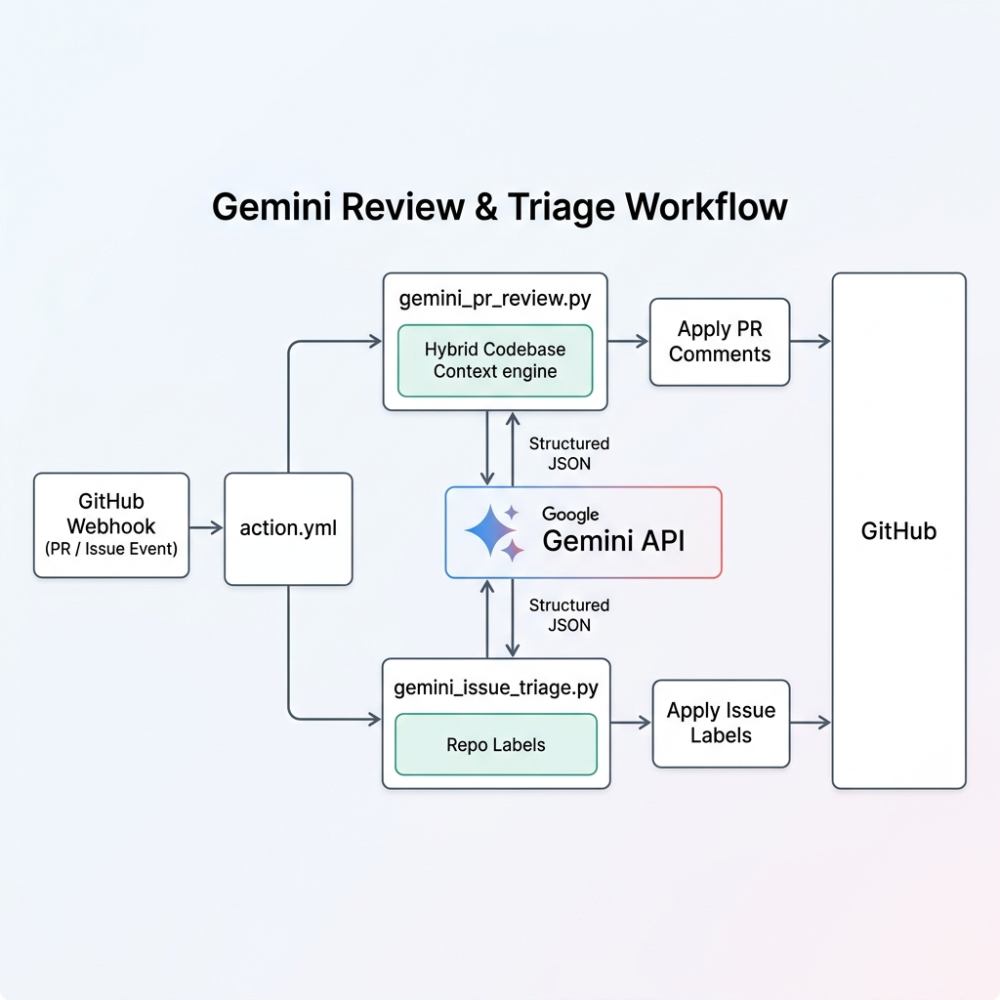

# Architecture & Code Walkthrough

This document provides a technical walkthrough of how the Gemini PR Review & Triage action is implemented, how it handles codebase context, and how the core Python scripts function.

---

## Architecture Overview

The action runs as a native GitHub Composite Action (`action.yml`) that boots a Python environment using `uv` for dependency management.



---

## Code Base Organisation & Package Architecture

The code review action is organized into a modular Python package (`gemini_review/`) separating domain responsibilities, with `gemini_pr_review.py` serving as the top-level execution entrypoint and backward-compatible API facade:

* **`gemini_review/schemas.py`**: Pydantic schemas defining structured outputs (`InlineComment`, `ReviewResult`, `DynamicContextSelection`).
* **`gemini_review/config.py`**: Configuration loader for `gemini-review.toml`, timeout/model defaults, context and image scope resolvers (`get_context_mode`, `get_max_context_bytes`, `get_attach_markdown_images`, `get_service_tier`, `get_service_tier_fallback`), exclusion pattern parsers (`get_diff_exclude_patterns`, `get_context_exclude_patterns`), and multimodal budget controls (`max_multimodal_images`, `max_triage_images`, `image_trigger_bytes`, `image_target_bytes`).
* **`gemini_review/multimodal.py`**: Multimodal MIME type detection and allowlist validation (`is_gemini_supported_mime`), in-memory SVG-to-PNG rasterisation via `resvg_py` (`rasterize_svg_bytes`), deterministic Pillow downscaling (`optimize_image_bytes`), local Markdown/HTML image reference extraction (`extract_markdown_image_references`), and remote issue screenshot extraction/authenticated fetching (`extract_remote_image_urls`, `fetch_remote_image`, `build_triage_multimodal_parts`).
* **`gemini_review/diff.py`**: Unified diff patch parsing, line numbering annotations (`format_diff_patch_with_line_numbers`), suggestion indentation alignment, line-range auto-correction, and inline comment filtering (`filter_review_comments`).
* **`gemini_review/repo.py`**: Safe baseline Git tree inspection (`ensure_git_ref_available`, `list_git_tree_files`, `read_git_tree_texts`), file discovery (`get_all_repo_files`), file tree formatting (`generate_file_tree`), core manifest pattern matching (`is_core_file`), PR diff glob filtering (`matches_exclude_patterns`, `filter_excluded_diff_files`), import extraction, and candidate pool ranking & bounding (`rank_and_bound_candidates`).
* **`gemini_review/context.py`**: Hybrid codebase context engine (Invariant `base_sha` Baseline Full mode, Working-Tree Full mode, Sparse mode, and `diff_only` mode), core documentation attachment, static extra context overrides, scoped Markdown multimodal context binding (`all | core | diff | none`) with prefix/tail separation, and Gemini dynamic context selection (`select_dynamic_context_files`).
* **`gemini_review/prompts.py`**: Custom instruction loaders (`load_custom_instructions`), system prompt builder (`load_system_instruction`), PR diff prompt formatting (`build_pr_diff_prompt`, omitting duplicate full-file copies for baseline-included, added, or removed files and enforcing `max_diff_full_file_bytes` water-fill caps), visual PR diff assembly (`build_visual_diff_parts`), and prompt assembly (`build_prompt`).
* **`gemini_review/utils.py`**: Core primitives (token estimation, response extraction, streaming connection-reset fallback `generate_content_with_stream_fallback`, `is_thinking_config_error` filtering, `create_genai_client`, `build_cache_tools`, multi-turn tool resolution `resolve_tool_calls_loop`, workspace rules discovery) and facade re-exports for backward compatibility.
* **`gemini_review/github.py`**: GitHub REST API client functions for PR files, comment threads, author filtering, review postings, and raw file blob retrieval (`get_file_blob`).
* **`gemini_review/threads.py`**: Pull request review thread retrieval and automated resolution of addressed threads (`resolve_addressed_threads`).
* **`gemini_review/budget.py`**: Token budget allocation (`prompt_token_budget`), aggregate full-file ceiling (`max_diff_full_file_bytes`), water-fill ceiling calculation (`compute_waterfill_cap`), and line-boundary content/patch truncation (`cap_file_content`, `cap_patch_content`) to prevent out-of-budget diffs.
* **`gemini_review/billing_labels.py`**: Google Cloud billing labels parser and sanitisation for GCP cost attribution.
* **`gemini_review/personas.py`**: Reviewer persona registry and prompt generation (`straight`, `dazbo`, `palpatine`, `rick`).
* **`gemini_review/pricing.py`**: Gemini model token pricing and cost estimation engine (supporting Gemini 4 Carbon, Neon, Argon, and Hydrogen, Gemini Decision 1, and Gemini 3.6–3.8 Flash).
* **`gemini_review/skills.py`**: Agent skill metadata parser and instruction loader for workspace and built-in skills.
* **`gemini_review/developer_knowledge.py`**: MCP/RPC integration to search and fetch official Google developer documentation.
* **`gemini_pr_review.py`**: Main CLI entrypoint script that re-exports all `gemini_review` package APIs and runs the primary review loop.

---

## 🔎 Pull Request Review Script (`gemini_pr_review.py`)

The PR review workflow is designed to retrieve PR details, collect local codebase context, build a structured prompt, and atomically submit line-specific reviews back to GitHub.

### 1. File Discovery & Filtering

* **PR Changes & Diff Exclusions:** The script fetches the list of changed files and their diff patches from the GitHub API using `get_pr_files()` (falling back to `git diff main...HEAD` locally). Optional `diff_exclude_patterns` (`GEMINI_DIFF_EXCLUDE_PATTERNS`) are normalised to POSIX paths and matched via `filter_excluded_diff_files()` (supporting recursive `**` globs) across both text and visual PR changes; excluded paths are also suppressed from background context assembly and logged clearly, exiting cleanly (`0`) if all PR files match.
* **Binary Exclusion:** Non-text files, binaries, lock files, and encrypted files are filtered out using `is_text_file()`.

### 2. Hybrid Codebase Context Engine

To provide Gemini with project-wide awareness without duplicating payload or breaking prefix caches, `gemini_pr_review.py` builds repository context first (`build_codebase_context()`, passing `base_sha` and separating `codebase_multimodal_parts` from `dynamic_multimodal_parts`) and forwards `baseline_included_files` into `build_pr_diff_prompt()`:

* **`context_mode` Routing (`auto | full | sparse | diff_only`)**:
  - `'auto'` (default): Uses Invariant Baseline Full Context Mode when baseline text files fit within `max_context_bytes` (default 1.5 MB), falling back to Working-Tree Full Context Mode if `base_sha` is unavailable, or Sparse Context Mode above `max_context_bytes`.
  - `'full'` / `'sparse'` / `'diff_only'`: Explicitly forces Full Context, Sparse Context, or Diff-Only (skipping repository file enumeration while still preserving optional `extra_context_files` and PR-diff Markdown images).
* **Per-File Content Truncation, Aggregate Water-Fill Cap (`max_diff_full_file_bytes`), and Prompt Budget Escalation**: Individual modified file contents are capped at 128 KB (`max_file_bytes`) with a loud truncation marker. Newly added/removed files and modified files already covered by `baseline_included_files` omit duplicate `Full Current File Content` blocks. Remaining modified full-file attachments respect the aggregate `max_diff_full_file_bytes` ceiling (default 256 KB, `0` disables) via `compute_waterfill_cap()`, while diff patches remain untouched unless the multi-stage window backstop triggers.
* **Invariant Baseline Full Context Mode (≤ 1.5 MB at `base_sha`)**:
  Ensures `base_sha^{tree}` is locally available via `ensure_git_ref_available()`, lists tracked blobs with `list_git_tree_files()` (excluding only `context_exclude_patterns`, intentionally retaining PR-changed files at their `base_sha` state), and reads all text payloads in a single binary `git cat-file --batch` call (`read_git_tree_texts()`). Static baseline Markdown images are read from `base_sha` (`get_git_blob()`) into the prefix, while newly added PR-diff Markdown images go into the dynamic tail.
* **Working-Tree Full Context Mode Fallback (≤ 1.5 MB without `base_sha`)**:
  If `base_sha` is absent (e.g. dry-run) or unreachable, reads working-tree text files via `get_all_repo_files()` and `get_file_content()` under `=== Repository Context (Full Codebase) ===`.
* **Sparse Context Mode (> 1.5 MB)**:
  If the repository exceeds the threshold (or `context_mode: 'sparse'` is set), the action activates Sparse Context Mode:
  1. **Visual Directory File Tree:** Generates a structured representation of the codebase using `generate_file_tree()`.
  2. **Core Manifests & Documentation:** Reads full contents of key configuration and root documentation files matching `core_file_patterns` (e.g. `README*`, `CONTRIBUTING*`, `ARCHITECTURE*`, `GEMINI.md`, `package.json`, `go.mod`, `pyproject.toml`) via `is_core_file()`, up to a configurable `max_core_context_bytes` budget (default 500 KB).
  3. **Candidate Bounding & Heuristics:** In large repositories or monorepos, candidate non-core files (already filtered against built-in exclusions and `context_exclude_patterns`) are ranked and bounded via `rank_and_bound_candidates()` using directory proximity, regex import references, and sister test/source naming, capping the candidate pool at `max_candidate_files` (default: 500) or strictly scoping to modified directories via `context_diff_directories_only`.
  4. **Dynamic Context Selection:** Invokes a structured Gemini model call via `select_dynamic_context_files()` to analyse the PR diff and evaluate the bounded candidate files against a 4-tier architectural prioritisation framework. It dynamically selects up to 8 of the most relevant sister modules, utilities, domain/algorithmic precedents, or unit test files to attach directly into the review prompt. Alternatively, specifying `extra_context_files` attaches specified files directly, bypassing the dynamic selector API call.
  5. **Telemetry & Thinking Support:** Thinking levels or token budgets configured via `thinking_level` are applied via `ThinkingConfig` with automatic resilient fallback if unsupported by the target model. Thinking tokens (`thoughts_token_count`) and dynamic context selection API usage are tracked, billed at output rates, and reported in the review comment telemetry table.


### 3. Gemini Context Caching Engine

To drastically reduce API costs and latency for large codebase contexts, `gemini_pr_review.py` automatically selects between Gemini 4's implicit prefix caching and Gemini 3's explicit `CachedContent` engine:

* **API Version Compatibility (`v1beta` across Developer API clients)**:
  Under `google-genai >= 3.0.0` (which switched the Gemini Developer API default to `v1`), `create_genai_client()` pins `api_version="v1beta"` in `HttpOptions` for all non-Vertex Developer API clients (covering both `gemini_pr_review.py` and `gemini_issue_triage.py`, across Gemini 4, Gemini 3 explicit `cachedContents`, preview/`-latest` aliases, and the Decisions API), while Vertex AI / Enterprise clients preserve their native `v1beta1` default.
* **Gemini 4 Automatic Implicit Prefix Caching (`gemini-4-*`, default)**:
  * **Zero Cache-Management Overhead**: When `gr._normalize_model_name(model_name)` starts with `"gemini-4"`, the script skips `client.caches.list()` and `client.caches.create()` (since Gemini 4 does not use explicit `CachedContent` handles).
  * **Prefix-Stable Prompt Ordering**: For uncached/direct requests, `gemini_pr_review.py` places static `codebase_context` (and `codebase_multimodal_parts`) *before* `dynamic_pr_prompt` (and `visual_diff_parts`). Because `system_instruction`, `tools`, and `codebase_context` come first, successive PR pushes and multi-turn tool calls retain an identical prefix and automatically receive Gemini 4's **95% cached-input discount** (`0.05x`) on prompts of 4,096+ tokens with no storage fee.
* **Gemini 3 Explicit `CachedContent` Provisioning & Reuse (`gemini-3.*`)**:
  * **Threshold Verification**: If the codebase context exceeds 100,000 characters (~32,768 tokens, Gemini's minimum explicit caching requirement), explicit context caching is activated.
  * **Deterministic Active Cache Lookup (`client.caches.list()`)**: Before creating a new cache, the script queries active server-side caches matching the display name `repo-cache-{repo}-{model}-{persona}-{fingerprint}`, where `fingerprint` is a short SHA-256 of the system instruction and cached context (text and multimodal parts). A cache is therefore only reused by a run that would have created an identical one, and caches created under a different model version are skipped to avoid `INVALID_ARGUMENT` errors.
  * **Stateless Zero-Infrastructure Persistence & Tenant Isolation**: No local state, runner disk storage, or database is required between workflow runs. Active context caches live on Google's infrastructure and are strictly isolated to your API key / GCP project namespace.
  * **Cache Provisioning (`client.caches.create()`) & 90% Discount**: If no matching active cache handle exists, the script provisions a new `CachedContent` resource containing `codebase_context`, `system_instruction`, and pre-parsed `tools`. Input tokens billed against the cached handle receive a **90% discount** across both initial generation and multi-turn tool calls.
  * **Resilient Fallback**: If explicit cache creation with multimodal attachments fails, the script retries cache creation with text-only codebase context (retaining visual PR diff parts on the generation request). If lookup, creation, or generation with `cached_content` still fails, it seamlessly falls back to direct context generation without interrupting the CI review pipeline.

### 4. PR Comment & Discussion Thread History Engine

When enabled via `include_comment_history: 'true'` (default), `gemini_pr_review.py` fetches complete historical discussion context from the GitHub API:

* **Inline & Conversation Retrieval (`get_pr_comments()`)**: Fetches inline review comments (`pulls/{pr_number}/comments`) and general PR issue comments (`issues/{pr_number}/comments`) using `while True` pagination loops (`per_page=100`) to guarantee all historical comments are captured.
* **Comment Author Filtering (`exclude_comment_authors`)**: Selectively filters out automated comments from secondary bots (such as `claude[bot]`) before prompt generation using `filter_comment_authors()`, preventing competing review conclusions from skewing the evaluation.
* **Thread Structuring (`format_pr_comment_history()`)**: Groups comments into root comments and nested developer replies per file and line number, presenting clear conversational timelines to Gemini.
* **Resolution Decision Matrix**: Instructs Gemini not to repeat suggestions that have been addressed in code, deferred, or explicitly justified by developers, while ensuring unresolved items without explanation or un-applied agreed fixes are re-flagged.
* **Automated Thread Resolution (`resolve_addressed_threads`)**: When enabled via action inputs, the action resolves GitHub review conversation threads using `fetch_review_threads()` and `resolve_addressed_threads()` for issues Gemini explicitly reports in `ReviewResult.resolved_items`, unblocking GitHub's *Require conversation resolution before merging* branch rule.

### 5. Multimodal Context & Visual PR Diffing Engine

`gemini_pr_review.py` and `gemini_review/prompts.py` seamlessly integrate multimodal content (images and PDF documentation) into the Gemini evaluation workflow:

* **Markdown Image Reference Extraction (`extract_markdown_image_references`)**:
  Whenever markdown documentation is included in the review prompt (core project documentation, diff additions, extra context files, or dynamically selected files), regex parsers extract local image paths referenced via standard Markdown (``) or HTML (``). Paths are resolved relative to the markdown file, validated against path traversal via `os.path.commonpath`, and attached as multimodal parts (`types.Part.from_bytes`).
* **Visual PR Diffing (`build_visual_diff_parts`)**:
  When a PR adds, removes, or modifies visual assets (`.png`, `.jpg`, `.jpeg`, `.webp`, `.gif`, `.svg`):
  - For modified images, both the baseline version (`base_sha`) and the updated version (`head_sha`) are retrieved via `get_file_blob()` (GitHub API) or `get_git_blob()` (local Git).
  - The assets are assembled into labelled before-and-after visual diff parts, enabling Gemini to review UI changes, layout consistency, and potential visual regressions.
  - Added and removed image assets are similarly captured with descriptive labels.
* **SVG-to-PNG Rasterisation & Deterministic Pillow Downscaling (`rasterize_svg_bytes`, `optimize_image_bytes`)**:
  Because the Gemini Vision API strictly rejects `image/svg+xml`, SVG assets (`.svg` or `image/svg+xml`) are first rasterised in memory to `image/png` via `resvg_py` (`rasterize_svg_bytes`). To prevent large raster graphics from inflating context token usage or request latency, raster images (including rasterised SVGs) exceeding `image_trigger_bytes` (default: 600 KB / 614,400 bytes) are resized using high-quality Lanczos resampling and re-compressed towards `image_target_bytes` (default: 300 KB / 307,200 bytes). PDFs (`application/pdf`) pass through uncompressed to preserve document layout. Every multimodal part is verified against `is_gemini_supported_mime()` (`GEMINI_SUPPORTED_PART_MIMES`) before attachment, and if a multimodal review request still fails with `400 INVALID_ARGUMENT`, `gemini_pr_review.py` gracefully falls back to a text-only review.
* **Safety Ceilings & Token Heuristics**:
  A configurable cap (`max_multimodal_images`, default: 20) bounds total multimodal attachments across context and visual diffs. The token estimation engine (`count_text_tokens`) incorporates a 258 tokens/part heuristic fallback for multimodal parts when offline or mocking API responses.

### 6. Structured Output Schemas

Gemini is forced to return structured JSON adhering to the Pydantic schemas:

* `InlineComment`:
  - `path`: File path.
  - `line`: Line number in the RIGHT (modified) side of the diff.
  - `side`: Diff side.
  - `severity`: Severity icon (`🔴`, `🟠`, `🟡`, `🟢`).
  - `comment_text`: Feedback string.
  - `code_suggestion`: Optional drop-in suggestion replacement.
* `ReviewResult`:
  - `summary`: High-level quality assessment.
  - `resolved_items`: List of previously raised review comments/threads resolved in the current PR iteration.
  - `general_feedback`: List of highlights or observations.
  - `comments`: List of `InlineComment` instances.

### 7. Resilient Generation & Review Submissions

Both LLM generation and GitHub review submission are hardened against network and payload faults:

* **HTTP Timeout Floor, Streaming Fallback & Flex Tier Retry (`create_genai_client`, `generate_content_with_stream_fallback`)**:
  The `google-genai` `HttpOptions(timeout=...)` parameter expects milliseconds, and large uncached prompts with thinking tokens enabled can take several minutes before the first response byte arrives. `gemini_pr_review.py` and `gemini_issue_triage.py` configure `HttpOptions(timeout=max(timeout, 300) * 1000)` (raised automatically to a **600-second minimum floor** when `service_tier='flex'` on AI Studio) and wrap generation calls in `generate_content_with_stream_fallback()`, which retries via `client.models.generate_content_stream` on dropped connections/resets, performs bounded retries (`5s`, `15s`) on transient Flex capacity-shedding errors (`503`/`429`/`504`), and falls back cleanly to Standard tier (`service_tier=None`) when `service_tier_fallback` is enabled. Because `GenerateContentConfig.service_tier` is Gemini Developer API–only, Vertex AI runs warn and enforce Standard tier.
* **Flex & Regional Pricing Telemetry (`gemini_review/pricing.py`, `gemini_review/github.py`)**:
  `estimate_cost()` halves listed token costs (`0.5×`) when Flex inference succeeded, restores `1.0×` pricing with an explanatory caveat if Flex fell back to Standard, and applies the `1.10×` Vertex AI regional surcharge whenever `GOOGLE_CLOUD_LOCATION` is non-`global` (such as `eu` or `us`), leaving custom `GEMINI_RATE_INPUT`/`GEMINI_RATE_OUTPUT` overrides untouched. `post_review()` renders optional `Service Tier` and regional `Endpoint` rows inside the telemetry table.
* **Atomic GitHub Review Run**:
  The script first attempts to post the summary, resolved items list (`### ✅ Resolved Items from Prior Reviews`), and all inline comments in a single transaction via `POST /repos/{owner}/{repo}/pulls/{number}/reviews`.
* **Resilient Comment Fallback**:
  If the atomic post fails (e.g. returns HTTP 422 because a line index falls outside the diff range), the script catches the failure, posts the review summary comment, and attempts to publish individual comments one-by-one. This ensures valid comments are still delivered while preventing a CI checkout block.

### 8. Review Prompt Customisation: Extending vs Replacing

The review prompt assembly in `gemini_review/prompts.py` provides two distinct customisation tiers:

* **Extending Instructions & Guardrails (`custom_instructions` / `load_custom_instructions`)**:
  Enables teams to layer on repository-specific guardrails, architectural standards, or forbidden libraries without discarding the built-in 5-axis quality evaluations or persona overlays. It resolves convention-based markdown files (`.github/review-instruction-additions.md` with fallback to `review-instruction-additions.md` at root), or inline text supplied via the `custom_instructions` action input in workflow YAML, seamlessly appending them under `## Additional Review Instructions & Guardrails:`.
* **Replacing Instructions Entirely (`gemini-review.toml`)**:
  When a repository needs to author a bespoke system prompt from scratch, placing `.github/commands/gemini-review.toml` in the repository completely replaces the base prompt template.

---

## 🏷️ Issue Triage Script (`gemini_issue_triage.py`)

The issue triage script automatically categorises and labels new or reopened issues using both text context and attached screenshots.

### 1. Label & Discussion Comment Retrieval

* The script calls `get_available_labels()` to fetch all labels currently configured on the repository, handling pagination dynamically.
* When comment history is enabled (`include_comment_history: 'true'`), `get_issue_comments()` retrieves existing issue discussion comments so follow-up context and screenshots are included.

### 2. Remote Screenshot Extraction & Multimodal Assembly

* `extract_remote_image_urls()` parses the issue body and discussion comments in document order for remote HTTPS image links (`` and ``), supporting extensionless GitHub user-uploaded asset URLs (`github.com/user-attachments/assets/...` and `githubusercontent.com/...`).
* `fetch_remote_image()` streams remote screenshots with a 20 MB size ceiling, attaching `Authorization: Bearer <GITHUB_TOKEN>` strictly for GitHub-hosted domains (`github.com` and `githubusercontent.com`) to support private/internal repositories without leaking credentials to third-party servers.
* `build_triage_multimodal_parts()` caps screenshots at `max_triage_images` (default: 5), downscales large raster images via `optimize_image_bytes()`, and attaches them as binary `types.Part.from_bytes` payloads alongside the triage prompt. If any remote download fails or times out, triage gracefully degrades to text-only classification.

### 3. Prompting & Classification

* The system instruction (loaded from `gemini-triage.toml`) instructs the model to act as a triage assistant and inspect both text and any attached screenshots.
* Using structured output, Gemini returns a `TriageResult` containing:
  - `selected_labels`: The subset of repo labels that match the issue.
  - `reasoning`: The explanation for applying those labels.
* The Gemini client enforces a 300-second minimum HTTP timeout floor (`types.HttpOptions(timeout=max(timeout, 300) * 1000)`), applies model-aware `build_thinking_config()` (clamping unsupported `'off'`/`'minimal'` levels to `'low'` on Gemini 4), and wraps calls in `generate_content_with_stream_fallback()` so connection resets recover via `generate_content_stream`.
* If multimodal triage fails (for instance, due to an upstream vision error), the script automatically retries with text-only triage (`triage_prompt`).

### 4. Deterministic Allowlist Filtering & API Label Application

* Before calling the GitHub API, `gemini_issue_triage.py` deduplicates `triage.selected_labels` in order and filters them strictly against the repository's `available_labels` allowlist, dropping any hallucinated or unrecognised labels with a warning.
* The script then calls `apply_labels()` to add the validated labels to the issue on GitHub.

---

## 🛠️ Configuration Architecture

The action maintains a strict separation of concerns between operational parameters and prompt templates:

* **Operational Action Inputs (`action.yml` / Workflow YAML)**: All operational configuration parameters (such as `gemini_model`, `context_mode`, `max_context_bytes`, `max_diff_full_file_bytes`, `attach_markdown_images`, `custom_instructions`, `exclude_comment_authors`, `resolve_addressed_threads`, `skip_inline_suggestions`, `include_comment_history`, `language`, `persona`, and `timeout`) are configured via action inputs in your workflow `.yml` file and mapped to environment variables (`GEMINI_*`).
* **Prompt Overrides (`gemini-review.toml`)**: `gemini-review.toml` is strictly reserved for custom system prompt overrides and legacy TOML context tuning thresholds:

```toml
# Default configuration
description = "Reviews a pull request using Google Gemini"
prompt = "..."

# Codebase Context Configuration (Optional)
max_context_bytes = 1536000  # Size threshold in bytes to trigger Sparse Mode (default: 1.5 MB)
max_core_context_bytes = 500000  # Max bytes for static core docs/manifests in Sparse Mode (default: 500 KB)
core_file_patterns = [
    "*.md",
    "pyproject.toml", "package.json", "go.mod", "Cargo.toml", "pom.xml",
    "build.gradle", "build.gradle.kts", "settings.gradle", "Gemfile",
    "composer.json", "*.csproj", "*.sln", "Dockerfile", "docker-compose.yml",
    "gemini-review.toml", "action.yml"
]
```

---

## 🏛️ Architectural Decision: Direct Gemini API vs. Managed Agents (Interactions API)

### Context & Evaluation

Google provides **Google Managed Agents** (such as the **Antigravity Agent**) via the stateful **Interactions API** (`interactions.create`). Managed agents execute inside a Google-hosted, OS-isolated Linux sandbox VM equipped with native tool harnesses (file mounting, shell execution, web search) and multi-turn state persistence.

During the architectural design of this action, I evaluated using Managed Agents (`interactions.create`) versus the direct Gemini Model API (`client.models.generate_content`) paired with native Gemini Context Caching (`client.caches`).

### Architectural Comparison

| Dimension | Direct Gemini API + Context Caching (Selected) | Managed Agents / Interactions API |
| :--- | :--- | :--- |
| **API Primitives** | `client.models.generate_content` + `client.caches` | `client.interactions.create` + `agent_config` |
| **Execution Environment** | Client-side Python runner on GitHub Runner | Google-hosted cloud Linux sandbox VM |
| **Codebase Context Strategy** | Prefix-stable implicit caching (Gemini 4) + explicit `CachedContent` (Gemini 3) | Repo mounted in VM sandbox via environment sources |
| **Input Token Pricing** | **90–95% discount** on cached tokens (implicit on Gemini 4; >100k chars explicit on Gemini 3) | Standard token pricing per interaction turn |
| **Startup Overhead & Latency** | Near-zero (direct token generation) | VM sandbox boot & cold-start latency per job |
| **State Management** | Stateless single-turn pass per PR commit | Persistent multi-turn sessions (`previous_interaction_id`) |
| **API Maturity** | GA (General Availability) | Public Preview |

### Decision Rationale

I selected the **Direct Gemini API + Context Caching** model based on the following technical trade-offs:

1. **Latency & CI Execution Speed**:
   Code review in a CI pipeline requires rapid execution feedback. Managed Agent sandboxes incur non-negligible cold-start boot latency when provisioning remote containers for each workflow trigger. Direct API generation starts producing feedback immediately.

2. **Context Caching Cost Optimisation (90–95% Input Token Savings)**:
   On Gemini 4 models (such as `gemini-4-hydrogen`), placing static `codebase_context` before the dynamic PR diff keeps the prefix invariant across pushes and tool turns so automatic implicit caching delivers a **95% discount** with zero cache management. On Gemini 3 models with large codebase contexts (>100,000 characters), the explicit caching engine creates a server-side `CachedContent` handle that receives a **90% discount** across workflow runs. Managed agent environments load context into a remote VM container filesystem, which does not benefit from these direct-API caching mechanisms.

3. **Appropriate Complexity for CI Workflows**:
   A Pull Request review is inherently a single-turn structured evaluation per git commit. The heavyweight architecture of a persistent Linux VM sandbox container (with mounted tool shims and session state tracking) introduces unnecessary complexity compared to a focused Python execution loop running on the native GitHub Action runner.

4. **Security & Credential Scope**:
   Passing repository access tokens into remote cloud VM sandboxes (even with egress proxy header transforms) broadens the credential trust boundary. Running the review logic locally on the ephemeral GitHub runner ensures standard GitHub Actions secret isolation.

5. **API Stability**:
   Direct API generation and Context Caching primitives are generally available (GA) with guaranteed SLAs, avoiding reliance on Public Preview APIs for production CI pipelines.

### References

* [Google Managed Agents Overview](https://ai.google.dev/gemini-api/docs/agents)
* [Antigravity Agent Documentation](https://ai.google.dev/gemini-api/docs/antigravity-agent)
* [Agent Environment Overview](https://ai.google.dev/gemini-api/docs/agent-environment)

---

## 🧭 Design Decisions: Prompt Volume Reduction & Invariant `base_sha` Prefix Caching

### Context & Problem

Empirical probing across Gemini 4 models highlighted two structural drivers of uncached input token cost:

1. **Full-file payload volume, line-number gutter inflation & background attachments**: Historically, `build_pr_diff_prompt()` attached line-numbered `Full Current File Content` (`   123 | ` prefixes costing ~3.5 tokens/line) for every modified file alongside uncapped multi-file payloads and full-repo background files in Full Context Mode. Moving modified files cleanly into the unnumbered `base_sha` baseline prefix and providing `context_mode` (`'sparse'`, `'diff_only'`) plus `max_diff_full_file_bytes` cuts both uncached AI Studio prompt size and line-number overhead while keeping every diff patch intact.
2. **Prefix mutation per PR**: Working-tree Full Context Mode filtered out `pr_filenames` (`skip_filenames`), punching different holes in the alphabetical prefix for every PR and every commit, while working-tree reads reflected PR edits inside the prefix. Because Gemini 4 only supports **implicit prefix caching** (explicit `CachedContent` is unsupported on Gemini 4; Vertex AI `eu`/`us` multi-region endpoints back Durable Implicit Caching, whereas AI Studio best-effort global implicit caching does not guarantee cross-run persistence), any prefix variation completely prevented cache reuse.

### Decisions & Rationale

1. **Keep `GEMINI_API_KEY` (AI Studio) First-Class — Never Require Vertex AI**:
   Most action adopters want a zero-setup GitHub secret rather than provisioning a GCP project and Workload Identity Federation. All volume-reduction features (`baseline_included_files` deduplication, `max_diff_full_file_bytes`, `context_mode`, `attach_markdown_images`) immediately cut uncached AI Studio costs without GCP setup, while Vertex AI users gain automatic cache reuse on the same invariant prefix.
2. **Invariant `base_sha` Baseline Snapshot Instead of Excluding `pr_filenames`**:
   In Full Context Mode, enumerating and reading **all** tracked text blobs at `base_sha` (excluding only `context_exclude_patterns`) means two different PRs or successive force-pushes targeting `main` share a byte-identical prefix (`=== Repository Context (Full Codebase Baseline) ===`). Meanwhile, `build_codebase_context()` runs *before* `build_pr_diff_prompt()` so modified files already covered by `baseline_included_files` omit their redundant `Full Current File Content` block (retaining full copies only for files omitted from baseline context, such as files excluded by `context_exclude_patterns` or Sparse Mode).
3. **On-Demand Shallow Fetch (`git fetch --no-tags --depth=1`) & Binary `git cat-file --batch`**:
   Most GitHub Workflows run `actions/checkout@v7` with its default `fetch-depth: 1`, meaning `base_sha` is absent from local `.git`. Rather than requiring every consumer workflow to switch to slow `fetch-depth: 0` clones, `ensure_git_ref_available()` validates the ref format (rejecting leading dashes, `..`, and whitespace), fetches solely the single `base_sha` tree when missing, lists sizes once via `git ls-tree -r -l -z`, and streams all blobs through a single binary `git cat-file --batch` subprocess using exact byte offsets so multi-byte UTF-8 and CRLF blobs never misalign. Offline or mocked environments fall back cleanly to Working-Tree Full Context Mode.
4. **Preserve `attach_markdown_images: 'all'` as Default with Prefix/Tail Separation**:
   Dropping background Markdown diagrams by default saves relatively little (~1,120 tokens/image on Gemini 4) at the risk of hiding architecture diagrams from the reviewer. The action therefore keeps `'all'` as the default (offering `'core'`, `'diff'`, and `'none'` as opt-in levers), reads baseline Markdown images from `base_sha` via `get_git_blob()` into the invariant prefix, and routes newly introduced PR-diff Markdown images into `dynamic_multimodal_parts` in the prompt tail alongside `visual_diff_parts`.
5. **Aggregate `max_diff_full_file_bytes` Water-Fill Bounding (Default 256 KB)**:
   When files are not in `baseline_included_files`, water-fill capping preserves small modified files in full while truncating giant modified files loudly on line boundaries — never trimming the unified diff patches themselves unless the model window budget backstop triggers.

